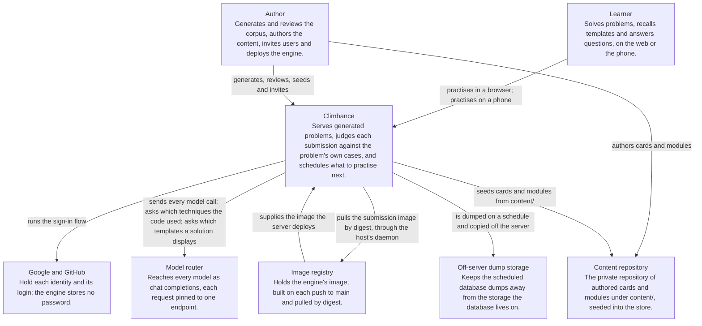
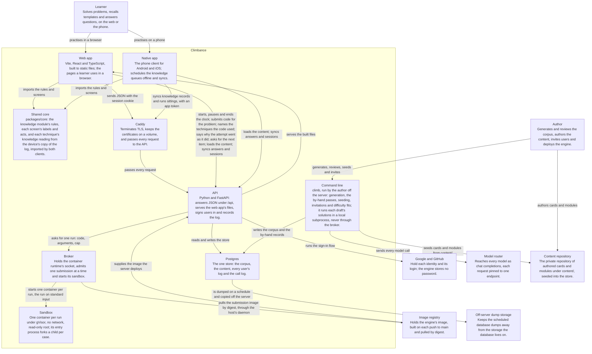
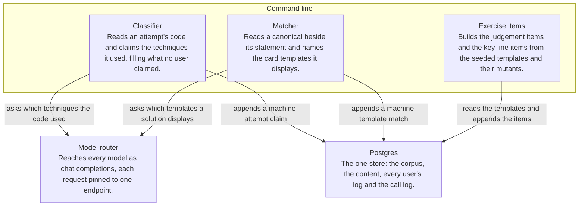

# Architecture

Target state, across this file and the ones beside it. The code lags these
files. On any difference, the doc wins.

<!-- generated from model.toml by `just model-views`, never edited -->

## Views

The engine's context: who uses it and what it reaches outside itself.

The engine's containers: what runs on its own, and what each talks to.

The API's components, and what each reads and writes.

```mermaid
flowchart TB
    web_app["Web app<br/>Vite, React and TypeScript, built to static files; the pages a learner uses in a browser."]
    native_app["Native app<br/>The phone client for Android and iOS; schedules the knowledge queues offline and syncs."]
    broker["Broker<br/>Holds the container runtime's socket, admits one submission at a time and starts its sandbox."]
    database["Postgres<br/>The one store: the corpus, the content, every user's log and the call log."]
    subgraph api["API"]
        sitting["Sitting<br/>Times one session on one problem, minted at the first clock press or submission, and ended where next read."]
        submission["Submission<br/>Takes a user's code for a problem, refuses it past the run caps, and mints the attempt carrying the result."]
        runner["Runner<br/>Runs code against a problem's cases, through the broker or the local subprocess, and reads each case's outcome."]
        run_faults["Run faults<br/>Stores a run the sandbox answered no result for, so the run caps count it."]
        attempt_log["Attempt log<br/>Appends each attempt and its attempt verification; private to the user."]
        attempt_claims["Attempt claims<br/>Stores which techniques an attempt's code used, the user's claim standing over the classifier's."]
        self_labels["Self-labels<br/>Stores the user's verdict on why an attempt went the way it did, as a failure mode."]
        template_schedule["Template schedule<br/>Replays each template's FSRS state from its reviews: recall attempts and sittings on problems written for it."]
        card_states["Card states<br/>Derives each card's state, from not started to graduated or lapsed, from the log on every read."]
        mastery["Mastery<br/>Computes each technique's recognition and execution from the log on every read."]
        pick["Pick<br/>Names the next item: a template and the act that reviews it, read from the three folds."]
        predictions["Predictions<br/>Stores what each pick expected, from FSRS and from mastery, before the user acts on it."]
        snapshot["Snapshot<br/>Serves the seeded content to both clients as one document, revalidated by its ETag."]
        knowledge_sync["Knowledge sync<br/>Stores a client's sync lines, refusing each line that names unknown content, and returns the user's records since a cursor."]
        knowledge_log["Knowledge log<br/>The nine append-only tables of the user's knowledge log: answers, stints, focuses and the rest."]
        problems["Problems<br/>Reads a problem from the corpus: its statement, its templates and its test cases."]
    end
    web_app -->|"starts, pauses and ends the clock"| sitting
    web_app -->|"submits code for the problem"| submission
    submission -->|"mints the sitting where no clock started"| sitting
    submission -->|"runs the code against the problem's cases"| runner
    runner -->|"asks for one run: code, arguments, cap"| broker
    runner -->|"records a run that answered nothing"| run_faults
    submission -->|"counts recent runs against the caps"| run_faults
    submission -->|"appends the attempt and its verification"| attempt_log
    web_app -->|"names the techniques the code used"| attempt_claims
    web_app -->|"says why the attempt went as it did"| self_labels
    template_schedule -->|"replays each sitting's verdict as a review"| attempt_log
    card_states -->|"reads which rungs are solved"| attempt_log
    card_states -->|"reads the recall probability of a spaced check"| template_schedule
    mastery -->|"scores execution per sitting"| attempt_log
    mastery -->|"credits the techniques an attempt used"| attempt_claims
    mastery -->|"reads the failure mode"| self_labels
    web_app -->|"asks for the next item"| pick
    pick -->|"reads each template's FSRS state"| template_schedule
    pick -->|"reads each card's state and next check"| card_states
    pick -->|"reads each technique's mastery"| mastery
    pick -->|"stores what the pick expected"| predictions
    attempt_log -->|"appends to the user's log"| database
    sitting -->|"revises the sitting in place"| database
    predictions -->|"appends each prediction"| database
    attempt_claims -->|"appends each claim"| database
    self_labels -->|"appends each label"| database
    web_app -->|"loads the content"| snapshot
    native_app -->|"loads the content"| snapshot
    web_app -->|"syncs answers and sessions"| knowledge_sync
    native_app -->|"syncs answers and sessions"| knowledge_sync
    knowledge_sync -->|"appends each line"| knowledge_log
    knowledge_log -->|"appends to the user's knowledge log"| database
    snapshot -->|"reads the seeded content"| database
    runner -->|"reads the problem's cases"| problems
    problems -->|"reads the corpus"| database
```

The Command line's components, and what each reads and writes.

<!-- end of the generated views -->

## Shape

The engine is public and the content is private. Everything the practice loop
reads is local to the engine, which never contacts external platforms.

Consequence: no third-party dependency in the drill loop.

**Problems are the product's own, and the engine writes them.** A statement
scraped from a platform cannot ship, which forces the question of where
problems come from. The answer is a capability of the engine rather than a
licence fix.

**The engine is the platform.** It serves a generated problem, times the
sitting, runs the submission against the problem's own test cases, and records
the verdict. Python only: a canonical is Python, the test cases are
Python-shaped, and a second language is a runner rather than a record change.

**The engine is a learning platform, not a competitive one.** A verdict is
evidence about the user's own practice and ranks the user against nobody. A
solver who games a verdict misleads only their own board. So the drill loop
shows what helps a solver debug, and does not guard a verdict against the
solver.

## Terminology

Words this project gives its own meaning. The files beside this one use them
without redefining them. Grouped by the file that specifies the record.

### Content

- **Technique**: one entry in the vocabulary of skills the log references. A
  procedure, a structure, a paradigm or a problem class. Shipped as code.
- **Vocabulary**: every technique, each with the criterion for claiming it.
- **Parent**: a technique another technique is a kind of, named on the
  narrower one's entry. `dynamic-programming` is the parent of `knapsack`.
- **Card**: the study material for one technique: what to read, the
  templates to reproduce from memory, and a selector for problems to solve.
- **Primary module**: the module a card names in `module`, whose subtopics
  support the card. Another module's subtopic naming the card's technique
  adds to the card and leaves the support unchanged.
- **Template**: one form of a technique, authored on a card, that a user
  reproduces from memory. Core by default.
- **Trigger**: the field on a card or a template saying when to reach for the
  technique or the form. A drawn recall shows the trigger alone, and
  withholds the form's title.
- **Speedup**: a flag on a template saying its form is asymptotically faster
  than the naive approach the technique replaces, by at least a factor of
  log n.
- **Selector**: a technique plus filters, on a card. The ladder is derived
  from it.
- **Ladder**: the problems a card has the user solve, derived from template
  matches and the selector. Never stored.
- **Rung**: one problem on a ladder. Required when it covers a core template.
- **Probe**: a problem assigned when a card is started, testing whether the
  form transfers to a problem it was not studied on. Never drawn from the
  ladder.
- **Card graph**: the cards as a directed acyclic graph, each edge from a card
  to a card it requires. Orders study, and gates card runs alone.
- **Requirement**: an edge of the card graph, authored on the requiring card.
  It names the required card, a core template there, and the template here
  that uses that form.
- **Root card**: a card requiring no other card.
- **Depth**: the longest chain of requirements below a card. Zero on a root.
- **Met**: a required card whose ladder the user solved, or one of whose
  run's probes the user solved. Never stored.
- **Locked**: a card some required card of which the user has not met. Its
  run does not start.
- **Template match**: a record saying one solution displays one template.
  Written by the generator, the matcher or by hand.
- **Matcher**: the model call reading a canonical beside its statement and
  naming the templates it displays.
- **User record**: a claim or match written by the user rather than a model. Its
  `source` is `user`. It is written by hand: in the drill loop, or in a
  `--by-hand` pass over what the loop never asked. It stands over every
  machine record on the same question.

### Corpus

- **Problem**: a statement, its test cases and its solutions, written by the
  engine. Never edited. Only its status moves.
- **Statement**: the prose a solver is served. It carries the signature of
  `solve`, the fixed name of the function every solution defines.
- **Test case** (case): positional arguments and an expected return. The
  case set is every case a problem carries, appended to and never revised.
- **Target**: what a problem is written for: a template, naming the form, or a
  technique, naming only the skill. The prompt a site is given is built from
  it. Stored as `target_template_id` or `target_technique` on the problem, the
  draft and the site outcome, one of the two.
- **Canonical solution**: an exemplary solution, written to display the
  approach rather than to pass.
- **Reference solution**: a solution written from the statement alone.
  Correct, and deliberately not exemplary. It computes the expected returns.
- **Naive solution**: the approach the template's form replaces, written told
  which form to avoid. The speedup search times the canonical against it.
- **Role**: which of the three a solution is: canonical, reference or naive.
  Stored, since all three pass the same cases.
- **Verification**: executing a solution against a problem's cases. A
  `Verification` record stores one run, with a case outcome per case: passed,
  wrong, timed out or crashed.
- **Cap**: the wall-clock limit on a case's `solve` calls, measured in the
  child process. Generation's cap sits well above the sitting's.
- **Repeat count**: how many times a case calls `solve` on its arguments, the
  cap covering the calls together. One on every case but a separating one the
  ceiling put out of reach.
- **Solution claim**: a claim about a solution the engine wrote. Product data,
  and what a problem's techniques are folded from.
- **Difficulty score** (score): a problem's difficulty as one number on the
  contest scale.
- **Contest scale**: the rating scale of the public programming contests,
  where a problem's rating is the contestant rating at which a solve is
  expected half the time.
- **Deviation**: one standard error of a score, on the contest scale.
- **Band**: the range of scores one label covers: easy, medium or hard.
- **Difficulty rating**: one judgement of a problem's score and deviation,
  written after landing, by hand or by a difficulty fit. A `DifficultyRating`
  record stores one.
- **Standing difficulty**: the score a problem is served with, its standing
  rating's, and the label of the band it falls in. With no rating, the label
  is the generator's `difficulty` and there is no score.
- **Panel**: the model configurations whose trials a difficulty fit reads,
  ranging from weak to strong. Each configuration is a **member**.
- **Trial**: one member's solution to one problem, with its verdict. A `Trial`
  record stores one. An attempt is a different thing: a user's solution.
- **Anchor**: an external problem whose contest rating was fitted from the
  contestants who solved it. Never served, never stored with the corpus, and
  never in git.
- **Anchor set**: the fixed list of anchors a fit reads, named by its hash.
  Some of its anchors are held out of the mapping.
- **Difficulty fit** (fit): one item response fit over the panel's trials,
  linked to the contest scale on the anchors. A `DifficultyFit` record stores
  one.
- **Defective**: a retirement reason: the statement asks for something its
  cases do not decide.
- **Enumeration**: a pass over a landed problem proposing other approaches,
  each generated as a further canonical. Deferred, as `corpus.md` gives.
- **Calibration corpus**: the platform problems and attempts under
  `data/old/`, kept for one deferred measurement: how often a matcher names a
  form from a statement alone.

### Generating a problem

- **Site** (call site): one of the six model calls writing a problem, each
  at its own configuration: generator, screen, blind, inputs, naive and
  discrimination.
- **Generator**: the site writing the statement, the canonical and the first
  cases in one call.
- **Screen site**: the site judging whether a draft reuses the example, the
  values or the wording of a published problem. It answers from what the model
  remembers, since the engine holds no published problem to compare with.
- **Copied**: reusing a published problem's example, values or wording. The
  gate the screen site rejects a draft by, and the retirement reason of a
  problem it names. A published question retold in the engine's own words is
  not copied.
- **Blind site**: the site writing the reference from the statement alone.
- **Inputs site**: the site writing the input generator.
- **Input generator**: model-written code building an input of a given size and
  seed.
- **Bound**: the largest input the statement admits, as the input generator's
  `size` counts it. Stored as `largest` on the draft and the site outcome.
- **Naive site**: the site writing the naive solution.
- **Discrimination site**: the site asked for cases that kill the surviving
  mutants.
- **Bench**: the configuration of each site a run is aimed with, from the
  `--site` flags or the built-in default.
- **Draft**: a problem being written, stored at every state so a failed step
  can resume. Cleared at landing.
- **Writing state**: how far a draft got: drafted, checked, screened,
  referenced, agreed, built, paced, searched, hardened, landed, or rejected.
- **Screened**: the writing state after the screen site found nothing copied.
- **Paced**: the writing state after a naive solution passed the cases. Named
  for the pacer, the runner who sets the time others are measured against.
  `unpaced` is the reason a draft has none.
- **Hardened**: the writing state after the mutation loop appended the cases it
  won. Named for hardening, making a thing resist attack.
- **Gate**: a check a draft must pass to advance. A failed gate rejects the
  draft or holds it, and is named on the site outcome.
- **Rejected**: a draft's terminal state. The gate names why: `no_value`,
  `copied`, `untested`, `disagreed` or `unexercised`.
- **Held**: a draft stopped at a state a resume can re-enter.
- **Landing**: the last step: the problem, its cases, its solutions, the
  verification runs of the canonical and the reference, and the generator's
  template match are stored together.
- **Resume**: `generate --resume`: re-entering every held draft at the first
  step whose configuration or prompt hash moved.
- **Mutant**: the canonical with one semantic change made on the parsed tree.
  A tree walk enumerates them, and no store holds them.
- **Kill**: a mutant failing at least one case, or answering a built input
  differently from the canonical.
- **Survivor**: a mutant no case and no built input killed.
- **Fuzz pass**: running the survivors against inputs the input generator
  builds. Costs no call.
- **Shrink**: reducing a kept fuzz input to the smallest list still killing
  the same mutants.
- **Kept input**: an input the fuzz pass built that killed a mutant, shrunk and
  stored as a case. `kept` on the draft.
- **Round**: one discrimination call, proposing cases for the survivors. At
  most two per draft.
- **Won case**: a round's proposal that killed a mutant, stored as a case.
  `won` on the draft and the site outcome.
- **Mutation loop**: the fuzz pass and the rounds together.
- **Speedup search** (the search): finding the smallest input on which the
  naive solution exceeds the sitting's cap and the canonical does not. The
  walk is the sequence of sizes it tries.
- **Separating case**: the case stored at the size the search found.
  Appended after the loop, naming no round.
- **Ceiling**: 1 MiB, the most a stored case may weigh.
- **Writing**: one run of the generation flow over one target, from the
  generator's call to landing or rejection. An attempt is a different
  thing: the log's record of a user's solution.
- **Site outcome**: the record of what one site left on one writing: the gate,
  the counters and the configuration.
- **Writing id**: the id a run mints per writing. The draft and its site
  outcomes share it.
- **Replay**: running the five answering sites over stored problems at a new
  bench. It writes nothing to the corpus.
- **Sweep**: one `generate` run over every target, or over every held draft.

### Execution

- **Sandbox**: what a submission runs under: a container with no network, a
  read-only root filesystem, a non-root user, dropped capabilities and limits
  on memory, processes and time. It shares the server's kernel.
- **Broker**: the process holding the container runtime's socket and starting
  one container per run. It answers one request, carrying the code, the
  arguments and the cap. Every other option a container is started with is
  fixed in the broker's own source.
- **Entry process**: the first process in a run's container. It reads the run
  from standard input, forks a child per case, and prints each case's result as
  one line on standard output.

### Machine records

- **Machine record**: any record a model call wrote: a claim, a match, a
  solution, a case's arguments. It carries provenance whole. Content a Claude
  Code session writes is not one, as `machine.md` gives.
- **Configuration**: model, effort, endpoint pin and temperature.
- **Provenance**: the configuration, the prompt hash of what was sent and the
  call that sent it.
- **Pin**: the endpoint a model id is fixed to, so one build answers.
- **Prompt hash**: the hash of the prompt a record was sent, `prompt_hash` on
  every machine record. Staleness keys on it.
- **Stale**: a record whose prompt hash differs from the one its site would send
  now. A re-run reads stale items and skips the rest.
- **Greedy** / **sampled**: temperature zero, or the provider's default. The
  answering sites are greedy. The generator and the naive site are sampled.
- **Call**: one request to a model and its response, domain-free. The call
  log holds every one.
- **Standing**: the record that answers a question when several were written
  about it. The user's stands over the machine's, and among the machine's the
  latest stands.

### The log

- **Attempt**: a user's solution to a problem, successful or failed.
- **Attempt verification**: executing an attempt's code against its problem's
  cases. An `AttemptVerification` record stores one run, and is private to the
  user where a solution's `Verification` is product data.
- **Sitting**: one session on one problem in the drill loop, timed or not,
  from the first clock press or submission. It may mint several attempts, and
  each of them carries the sitting's id. The record is revised while the
  sitting runs and kept after the sitting ends.
- **Pause**: an interval a sitting's clock is stopped for. The elapsed time a
  sitting reports excludes every pause.
- **Clock preference**: whether a sitting's clock starts by itself when the
  statement is served. The user's last press on a clock sets it, and the
  browser keeps it.
- **Drill loop**: the practice flow: pick a technique and a problem, read the
  card, solve, then answer the claim and the label.
- **Claim**: a record naming the techniques a piece of code used, by a named
  writer. Latest wins, and the user's stands over the classifier's.
- **Attempt claim**: a claim about the user's own attempt. Private, and what
  the board counts.
- **Classifier**: the model call reading an attempt's or a solution's code for
  the techniques it used. As a `source` value on any record, `classifier` means
  a model wrote it, whichever call.
- **Decline**: a claim stating that none of the candidates apply. Distinct
  from an empty claim, which answers nothing.
- **Fallback**: the problem's own techniques, answering an attempt no claim
  covers.
- **Labelled mutant**: a mutant of a template's form, read from a flawed
  judgement item or a key-line item's wrong choice, labelled `rust` and named
  by its operator. The diagnosis call is scored against the labelled mutants.
- **Self-label**: the user's own verdict on why an attempt went the way it
  did.
- **Diagnosis**: the machine's verdict on why an attempt failed, naming a
  cause. A `Diagnosis` record stores it.
- **Diagnosis call**: the model call reading a failed attempt or a labelled
  mutant and naming its cause.
- **Tool**: a piece of evidence the diagnosis call is given beyond its
  baseline, such as the first case the solution failed. Each is scored by the
  difference it makes.
- **Mutant diagnosis**: the diagnosis call's verdict on a labelled mutant. A
  `MutantDiagnosis` record stores it, keyed to the mutant.
- **Cause**: where a diagnosis places the fault: `slip`, outside the form the
  solver held, or `form`, in the form itself.
- **Failure mode**: why an attempt went the way it did, as one of five words a
  self-label names. `speed` is the time the solver took,
  and `rust` a form the solver held and did not reach. `gap` is a form the
  solver did not hold, `syntax` a slip in code the solver could have written
  correctly, and `none` an attempt that went the way it should.
- **Feedback**: a user's note to the author about the engine, naming the
  client and the page it was sent from. The author reads it with `climb
  feedback`.
- **Run fault**: a user's run the sandbox answered no result for, stored so
  the run caps count it.
- **Retirement request**: a user's request that a problem be retired, naming
  a retirement reason and a note. The author reads it and retires the problem
  by hand.
- **Card run**: the record that a card was started, and the probes it was
  given.
- **Pick**: the one problem or recall the board serves, read from FSRS,
  mastery and the cards' states.
- **Prediction**: what a pick expected as the user took it, from FSRS and from
  mastery, each with the settings that made it. A `Prediction` record stores
  one.
- **In flight**: a card acquiring, or consolidating with its spaced check open
  or owed. The pick offers a new card only while fewer than two are in flight.
- **Card state**: how far one user's study of one card has gone: not started,
  acquiring, consolidating, graduated or lapsed. Derived from the log, never
  stored.
- **Acquiring**: the card state of a started card with a required rung not
  solved since the run began.
- **Consolidating**: the card state once every required rung is solved, until
  the card graduates.
- **Graduated**: the card state once the graduation rule held, until a lapse.
  A graduated card is done.
- **Lapsed**: the card state of a graduated card one of whose templates has
  since had a review rated Again.
- **Recall attempt**: one template reproduced from memory, with the hints
  taken.
- **Recall probability**: FSRS's retrievability of one template for one user
  at a moment, read from the replay of its reviews.
- **Spaced check**: the recall a consolidating card's template waits for. It
  opens and falls owed at two recall probabilities, as `log.md` gives.
- **Short exercise**: a question about code answered in seconds with no
  typing, such as judging a solution. Each kind is a record kind of its own.
- **Judgement item**: a template's form, clean or carrying one mutant that
  fails a case, served by the judging exercise. Product data.
- **Judgement**: one user's answer to a judgement item: clean or flawed, and
  the tapped line where flawed.
- **Key-line item**: a template's form with one line blanked, and the choices
  for that line: the form's own line and mutants of it that fail a case,
  served by the key-line exercise. Product data.
- **Fill**: one user's answer to a key-line item: the choice the user picked.
- **Review**: one check that a user still holds a template's form or a
  question's fact. An answer to a seen question is a review of it, and so is
  a template's recall attempt or a sitting written for the template.
- **Board**: the per-technique view of progress, derived from attempts and
  claims. Never stored.
- **Mastery**: how well a user knows one technique, in three parts:
  recognition, execution and knowledge. Computed from the log on every read,
  never stored.
- **Recognition**: seeing that a problem needs a technique when nobody named
  it. Counted from recognition drills alone.
- **Execution**: writing a correct solution once the technique is known.
  Counted from sittings.
- **Knowledge**: recalling the facts a technique rests on. Counted from
  answers to the questions the technique carries.
- **Recognition drill**: a problem shown without its technique, where the user
  describes the approach in words and runs no code.
- **Framing judge**: the model call grading a recognition drill's description
  against the problem's canonicals.
- **Eval set**: the hand-claimed attempts a classifier configuration is
  scored against.
- **Adjudication**: resolving each divergence between the user's blind claims
  and a frontier model's claims, by editing the criterion or the claim.

### Knowledge

- **Module**: one subject of declarative knowledge, such as Python or system
  design. A module holds topics, and a topic holds subtopics.
- **Level**: how deep a question goes, one of four: 0 Foundation, 1 Associate,
  2 Professional and 3 Expert. A problem's difficulty is a different field.
- **Group**: one subtopic at one level, the unit gating and coverage count.
- **Question**: one fact asked about, in one of three formats: `choice`,
  `short` or `open`.
- **Open question**: a question the user answers in their own head, then
  grades by ticking the points of its key they recalled.
- **Concept**: one claim about a module's subject, with its source, its
  witness and the wrong beliefs about it. A lesson section teaches it and a
  question tests it. `docs/authoring/concepts.md` gives the record.
- **Witness**: code whose output shows a concept's claim holds, run on every
  supported build by the module check.
- **Key**: the two to six points an open question's answer has to contain.
- **Trap**: a known wrong claim, listed on an open question.
- **Answer**: one reply to a question, by one user. Distinct from an attempt,
  which is a user's solution to a problem.
- **Question state**: unseen, weak, due, learning or retained, replayed from
  the user's answers on every read.
- **Retained**: the question state once FSRS stability reaches 21 days.
  Distinct from mastery, which is per technique.
- **Servable**: a question a queue may serve now: unseen, or past its due
  time.
- **Gating**: the rule opening a group's new questions once the lower levels
  and the prerequisite subtopics are done.
- **Frontier**: the open groups that are not done, where new questions come
  from.
- **Lesson**: a short text teaching one or more groups, read before their new
  questions.
- **Pretest**: how many of a lesson's questions a user may meet before reading
  the lesson.
- **Queue**: a sequence of questions picked one at a time from what is servable:
  the next queue, the review queue or the filtered queue.
- **Filtered queue**: the queue serving questions the user chose by topic,
  subtopic, level or kind, locked or not.
- **Stint**: the record of one queue or one exam, stored when it stops.
- **Baseline test**: a sample of a topic's questions, asked before its first
  lesson, whose answers the schedule ignores. Distinct from a lesson's pretest.
- **Delayed test**: the baseline test's questions asked again four weeks or
  more later. The difference in score is the learning gain.
- **Measure**: the test an answer was given in, `baseline` or `delayed`.
- **Focus**: the module, topic, subtopic or certification the next queue is
  aimed at.
- **Module status**: active, paused or archived, set by the user.
- **Certification**: one scope, a topic or a whole module, at one level. Earned
  on coverage, retention, an exam and its prerequisites.
- **Projection**: a reading of the user's knowledge log forward, derived on
  every read and never stored.
- **Review forecast**: the projection counting the reviews each of the next
  fourteen learning days will hold, every review assumed to pass.
- **Snapshot**: the whole content of every live module as one JSON document,
  at snapshot format 6, which both clients load.
- **Sync line**: one knowledge record as a client writes it and the sync
  carries it, named by its kind and its `client_id`.
- **Outbox**: the knowledge records a client holds that the engine has not
  acknowledged, kept in the client's copy of the user's log.

### The native app

- **Native app**: the engine's client on a phone, built from one codebase for
  Android and iOS. It runs the knowledge module's rules from `packages/core`,
  as the web app does, and starts without a connection, which the web app
  cannot.

### The pages

- **Section**: one of the four destinations both clients' navigation names:
  Practice, Problems, Cards and Knowledge. Every page sits under one of them
  or under neither.
- **Guide**: the page saying what each kind of practice trains and where a
  new user starts, linked from the board while the user's log holds no act.
- **Gallery**: the page showing every design token and every component the
  pages use, built in development alone.

## Where the rest lives

This file is the map: what the system is, where it ends, and what holds at all
times. Each record class is specified in one of the files beside it.

| File | Holds |
|---|---|
| [`concepts/techniques.md`](concepts/techniques.md) | The technique vocabulary and how a technique is claimed |
| [`content-repo/`](content-repo/README.md) | Cards, the card graph, how a card and a subtopic share a technique |
| [`cli/matcher.md`](cli/matcher.md) | Template matches |
| [`cli/exercise-items.md`](cli/exercise-items.md) | Judgement items and key-line items |
| [`corpus.md`](corpus.md) | Problems, test cases, solutions, solution claims, difficulty ratings and fits, trials |
| [`log.md`](log.md) | Sittings, attempts, attempt verifications, claims, self-labels, diagnoses, card runs, recall attempts, the mastery derived from them, the predictions each pick stores, retirement requests, run faults and feedback |
| [`machine.md`](machine.md) | What a model-written record carries, what a generation run's call sites leave, and the call log |
| [`flows.md`](flows.md) | Generating a problem, the states it is written through, replaying a site, the drill loop, starting a card run, solving a rung, recalling a template, which sittings review a template, the pick, adjudicating the eval set |
| [`pages.md`](pages.md) | The web app's sections and pages, every screen of both clients and how the two differ, a page's areas, the design system |
| [`wireframes.md`](wireframes.md) | Each page drawn at low fidelity |
| [`knowledge.md`](knowledge.md) | Modules, where their authoring rules live, questions, lessons, the schedule, the queues, certifications, the baseline and delayed tests, and the user's knowledge log |
| [`model.toml`](model.toml) | The engine's context and containers as one model: each element's stable ID, its role, the doc section that specifies it, and its relations |

## Data classes

| Class | Owner | Visibility | Write semantics | Source of truth |
|---|---|---|---|---|
| Techniques | product | global | read-only at runtime | this repo, in git |
| Cards | product | global | read-only at runtime | the store, seeded from `content/` |
| Modules and questions | product | global | refreshed by the seed | the store, seeded from `content/` |
| Drafts | product | global | revised in place | the store |
| Problems | product | global | created once; only its status moves | the store |
| Test cases | product | global | written with the problem | the store |
| Solutions | product | global | append-only | the store |
| Solution claims | product | global | append-only | the store |
| Difficulty ratings | product | global | append-only | the store |
| Difficulty fits | product | global | append-only | the store |
| Trials | product | global | append-only | the store, or beside the anchors for an anchor's trial |
| Verification runs | product | global | append-only | the store |
| Template matches | product | global | append-only | the store |
| Mutant diagnoses | product | global | append-only | the store |
| Judgement items | product | global | created once; only its status moves | the store |
| Key-line items | product | global | created once; only its status moves | the store |
| Site outcomes | product | global | append-only | the store |
| Sittings | user | private | revised in place | the store |
| Card runs | user | private | append-only | the store |
| Recall attempts | user | private | append-only | the store |
| Judgements | user | private | append-only | the store |
| Fills | user | private | append-only | the store |
| Predictions | user | private | append-only | the store |
| Retirement requests | user | private | append-only | the store |
| Feedback | user | private | append-only | the store |
| Run faults | user | private | append-only | the store |
| Attempts | user | private | append-only | the store |
| Attempt verifications | user | private | append-only | the store |
| Attempt claims | user | private | append-only | the store |
| Calls | product, or user where only a user's record names the call | global, or private with that record | append-only | the store |
| Users | user | private | created once | the store |
| Identities | user | private | revised in place: the email at each sign-in | the store |
| Sessions and app tokens | user | private | revised in place: last use and revocation | the store |
| App codes | user | private | revised in place: redeemed once | the store |
| Invitations | product | private | added and deleted by the author | the store |
| Self-labels | user | private | append-only | the store |
| Diagnoses | user | private | append-only | the store |
| Answers, stints, module statuses, focuses, lesson marks, certification exams, setting changes, limit raises, module orders | user | private | append-only | the store |

## Boundaries

- **Verification runs locally**, so every submission is judged by whatever
  ran it.
- **The engine runs on one virtual server, and Docker Compose starts its
  containers.** The API, the frontend's files, Postgres and the sandbox share
  that server. A host running only functions is rejected, since a submission
  needs a container runtime. This file gives the shape the engine depends on:
  one server, what shares it, and what a failure costs. The provider, the sizes
  and the commands that build the server are in the deployment repo.
  - Postgres writes to storage that outlives the server. A lost server is
    replaced by creating another and attaching that storage again, so losing
    the server costs the time a rebuild takes rather than the log.
  - The database is dumped on a schedule, and the dump is copied off the
    server. A dump left on the same storage as the database is lost with it.
  - Each client reports an error it did not handle, and the API writes the
    report as one line of its log. The report names the user, the client,
    the build, the page and the error's message and stack, and no code the
    user typed. A table is rejected, since the log already keeps 14 days and
    the privacy policy already states them.
  - A client sends each distinct error once per load, and the API refuses a
    user's reports past 10 a minute. A render failing in a loop would
    otherwise fill the log. The API counts the reports in memory, per worker,
    since a report is no stored record.
  - Every service logs to the host's journal, which keeps 14 days. Docker's
    default log driver keeps every line until the disk fills. The privacy
    policy states the 14 days, and the deployment repo sets the journal's
    retention.
  - One server carries no failover, and that is accepted. A second server
    carries a second Postgres, which needs replication, automatic failover and
    a rule stopping both servers from accepting writes at once. The failures
    this size of deployment meets are a bad deploy, a full disk and a
    submission eating the memory, and a second server answers none of them.
  - The server, the volume, the firewall and the commands that rebuild them
    live in a private repo of their own. This repo is read as public, and the
    server's address is not.
  - The image carries the compose file it is deployed with, at
    `/app/deploy/compose.yaml`, and the server extracts that file from the
    image it pulled. The server clones no repository and holds no credential
    reading one, and deploying an older image restores the service definitions
    that image was built with.
  - A push to main builds the image, pushes it to the registry, and sends the
    server one command naming that image by digest. The key that command
    arrives on carries a forced command, so a holder of the key deploys an
    image and runs nothing else.
  - Secrets reach the server as a file the server alone holds. Whoever can pull
    an image can read what was built into it, so a secret is never built in.
  - Postgres listens on the server's loopback address, and a command run off
    the server reaches it through an SSH tunnel. The generation commands write
    to the store from wherever the author runs them, and the tunnel gives them
    the store over the port that is already open.
  - Opening the database's port to the author's address is rejected. An open
    port is reachable from outside the server, and a password guards it. The
    tunnel is guarded by a key instead, and it opens no further port.
- **A submission runs in a container the broker starts, and the API reaches no
  container runtime.** The image, the flags and the limits are fixed in the
  broker's source. No field of a request names an image, a mount or a
  capability.
  - An API holding the container runtime's socket would turn its own
    compromise into a root shell on the server. A request to that socket can
    start a privileged container with the host's filesystem mounted into it,
    and the API is the process running whatever a signed-in person submits.
  - The broker starts a container with the docker CLI, and the fixed flags are
    one argument list in the broker's source. The request reaches the entry
    process on standard input through `docker run -i`. Docker's HTTP API needs a
    hijacked connection to write a container's standard input, and the Docker
    SDK for Python is untyped.
  - One container holds a whole run, and the entry process forks a child per
    case inside it. No case observes another, as `corpus.md` requires. A
    container per case would pay a container's start once per case, where a
    fork costs far less.
  - The submission's image carries a Python interpreter and no engine code.
    The broker sends the entry process's script with each run, as `python -c`,
    so the script always matches the deployed broker. The submitted code arrives
    on standard input, so a run mounts nothing.
  - The broker names the submission's image by digest, and pulls that image
    when it starts. A tag moves under the run a stored verdict was measured by.
    The host's daemon carries out the pull on the broker's behalf, since the
    broker's own network leads nowhere outside.
  - Each case's child points its standard streams at `/dev/null` and returns its
    result to the entry process over a pipe. The entry process prints one line
    per case on standard output. A solution's own prints therefore never reach
    the output the broker parses.
  - Each case's child holds an address-space limit under the container's memory
    limit, so a case that exhausts memory raises inside that child and fails
    alone. Under the container's limit alone the host kills the whole
    container, which leaves every later case of the run unanswered.
  - Each case's child holds a process limit under the container's, for the same
    reason. gVisor backs every process a case starts with a host process, so a
    case reaching the container's limit ends the sandbox itself. The process
    limit counts every process of a user, so the entry process sets it only
    where the broker marks the container as the run's alone.
  - gVisor mounts a tmpfs over `/tmp` inside the container, so a solution
    writes there however read-only the root filesystem is. That tmpfs is
    removed with the container, and what it holds counts against the
    container's memory limit.
  - The broker runs from the engine's image, under a command of its own. An
    import contract keeps the broker's module from importing the rest of the
    package, so the process holding the socket loads no engine code. A second
    image would add a second digest to every deploy.
  - The broker runs as a non-root user in the host's `docker` group. That group
    already controls the host through the socket, so running the broker as root
    would add only write access inside the broker's own container. The group's
    id differs between servers, so the server writes it into the secrets file
    and compose reads it from there.
  - The API reaches the broker over HTTP, on a compose network that only the API
    and the broker join. Caddy and Postgres cannot open a connection to the
    broker. A shared token was rejected, since the separate network guards the
    broker with no secret to rotate.
  - A submission runs in the local subprocess wherever no broker is configured.
    gVisor runs only on Linux, so a sitting on the author's laptop uses the
    subprocess. The broker's own tests run where Docker and gVisor are
    installed.
  - The container runs under gVisor, a kernel written in user space that
    answers the container's system calls. An exploit of the host's own kernel
    reaches gVisor first. The broker names the runtime as a constant.
  - gVisor answers a system call more slowly than the host's kernel does, and a
    verdict is wall clock against the cap. So the canonicals are timed under
    gVisor, and a separating size found on the local subprocess is measured
    again there. Installing gVisor after that measurement would spend it twice.
    Under gVisor at the sitting's cap, the 50 served problems' canonicals ran
    all 506 of their cases, and none took over a tenth of the cap.
  - A virtual machine per submission is deferred until access is opened beyond
    invitations. gVisor's KVM platform needs `/dev/kvm`, which this server does
    not offer, so the step is a microVM service rather than a flag.
  - The sandbox moves to a server of its own at the same point. An escape then
    crosses a network before it reaches Postgres.
  - Submissions run one at a time, and the broker admits them. A verdict is
    wall clock against the cap, so a submission running beside another measures
    the contention between them. The broker is one process, so the limit holds
    however many API workers there are, where a limit inside the API would hold
    only within one worker.
  - A submission waiting for the broker is refused once the wait passes a
    bound. A submission that waits without a bound looks to the user like a
    sandbox that hung. The wait changes no verdict, since the cap is measured
    in the child around the `solve` call.
  - A user's submissions are capped at 10 a minute and 60 an hour, and a
    user's recalls are capped by the same bounds. Each runs untrusted code on
    the server, and the broker admits one run at a time, so one user's burst is
    every other user's wait. Each cap is counted over the user's own records of
    its window, and a run past it is refused before any container starts.
  - A run the sandbox answers no result for is stored as a run fault, and
    the caps count it. A solution can end its own container, and the run held
    the broker as long as a judged one. `log.md` gives the record.
  - A user's submissions and recalls are counted apart, each against the
    bounds. A recall runs a template's few cases where a submission runs a
    problem's whole set, and one counter over both would refuse the cheaper run
    for the more expensive one's burst.
  - The hour's cap is needed beside the minute's. A run of ten cases that all
    time out holds the broker about 20 seconds, so 10 runs a minute already
    keep the broker busy, and the minute's cap alone admits 600 an hour.
  - A cap on the sandbox time a user takes in an hour is deferred until real
    use shows one user filling the broker's queue under the counted caps. It
    would sum the case times each run already stores, a timed-out case counted
    at the cap, so it limits the resource the users share rather than a count.
  - A run's code is refused past 65,536 characters, before any container
    starts. A solution is a few kilobytes, and the code reaches the broker and
    the container whole.
  - A run's container holds one CPU. A container with no CPU limit takes every
    core it can, which slows the API and Postgres beside it. A `solve` call is
    single-threaded, so the limit takes nothing a solution uses, and gVisor's
    own threads share the same quota.
  - Generation runs off this server. The mutation loop starts many subprocesses
    at a cap well above the sitting's, so a generation run beside a sitting
    moves the wall clock that sitting's verdict is read from. Generation writes
    the corpus rather than serving a page, so it runs wherever the author is.
  - Several submissions run at once only where each run holds a core of its
    own. Two runs sharing a core measure each other, and two runs on separate
    cores share memory bandwidth alone. A longer queue admits more submissions
    without changing what either one measures.
- **The web app is served from one origin.** The API answers JSON under
  `/api`, and the frontend is built to static files. Locally, Vite serves the
  files and proxies `/api` to the API. Deployed, the API serves the built files
  beside `/api`, and Caddy in front of the API holds the certificate.
  - A second origin is rejected. Every request would need CORS, and the session
    cookie would have to cross domains.
  - A path naming no file is answered with `index.html`. The frontend routes
    its pages by URL, so a reload of any page reaches the app rather than a
    404. A path under `/api` naming no route stays a 404.
  - Caddy terminates TLS and passes every request to the API. Caddy issues and
    renews the certificate itself, so no certificate is handled by hand.
  - Caddy serving the files itself is rejected. The files are built into the
    engine's image, and Caddy could reach them only through a second image the
    deploy also pushes, or a volume the API fills at start and a rollback
    leaves stale.
  - Caddy keeps its certificates on a volume. Without the volume a redeploy
    issues a certificate again, and the certificate authority limits how often
    it issues one.
- **The web and the native app import one TypeScript package,
  `packages/core`, and each keeps a look of its own.** The two apps are ways
  into one learner model, and each feature sits on the platforms where it
  works.
  - Three layers divide the code. The rules live in the core, as one copy.
    A screen's labels, counts and offered acts live in the core too, tested
    once. The look and the interaction belong to each
    platform.
  - A platform may change how a thing looks and how it is used, and never
    what it computes, says or offers. A difference in what two platforms say
    is a bug, and a difference in how they look is a choice.
  - The knowledge queues are scheduled on the device by the core, on the web
    and the phone alike. The phone must work offline, and one user practising
    on both has to see one behaviour.
  - The server schedules what depends on the server already: the pick of a
    sitting or a recall, mastery, the stored predictions and any reminder sent
    while the app is closed. FSRS replay and the question states therefore
    exist in TypeScript and in Python, held together by the shared fixtures.
  - A sitting and a recall are typed on both clients. The phone types them
    through a keyboard of the app's own, since the system keyboard hides the
    symbols code is made of and completes words. `pages.md` lists what each
    client holds.
  - The web app wrapped in a WebView, as Capacitor ships one, was rejected.
    Every screen would then scroll, type and navigate through a WebView, where
    a native screen gets the platform's own lists, sheets and back gesture.
  - The phone's code editor is the one WebView, inside a native screen:
    CodeMirror, typed through the app's own keyboard. One editor setup then
    serves both clients. The system keyboard is the part of a WebView that
    handles worst, and the app's keyboard replaces it.
  - A key reached the painted editor in 23 ms at the median. On 2026-11-11 a
    nine-line binary search was typed through the app's keys on a Redmi Note
    13 Pro 5G at 120 Hz. Over 126 keys, the time from the press to the second
    animation frame after CodeMirror applied the key was 23 ms at p50, 27 ms
    at p90 and 48 ms at most. The message across the bridge took 6 ms of it.
  - The editor scrolled as a native list does. Over the same flings and
    drags, the editor and the native Problems list each missed one frame
    deadline in about 4,000 frames. The editor's frames took longer: 11 ms
    against 9 ms at p50, and 19 ms against 14 ms at p99.
  - A key reaches CodeMirror as typed input, after a forced parse. CodeMirror
    reindents `else:` only on a transaction marked `input.type`, and reads a
    syntax tree its parser fills in idle time. Without both, `else:` kept the
    indentation of the line above it.
  - Enter after `else:` indents to the level of `else` rather than of its
    body. Node reproduces it with the same packages, so the web's editor does
    the same, and the dedent and indent keys correct it on the phone.
  - A native rewrite in Kotlin and Swift was rejected. Every rule and every
    screen would exist three times, and each copy would need testing on a
    device.
- **The native app schedules the knowledge queues offline.** It runs the
  knowledge module's rules from `packages/core`, and syncs with the engine
  through the API.
  - The app answers questions with no network. A queue picks each question at
    the moment it is needed, so a round trip per pick would stall practice on
    a train or a plane.
  - The Python side generates the fixtures, and both suites check them. A
    fixture is regenerated from the Python side, never edited by hand, so a
    rule changed in one copy fails the other copy's tests.
  - `just fixtures` generates the cases of the rules Python holds: FSRS replay
    and the question states. A rule only TypeScript holds, such as gating or
    a queue, keeps the cases generated before the merge until a server
    feature reads that rule.
  - A rule changes in `knowledge.md` first, then in both copies. The doc is
    the contract the fixtures are generated against.
  - The app served the knowledge modules first, and the rest of the engine
    followed feature by feature. The phone now holds every page but the
    gallery, and `pages.md` lists what each client holds.
  - The app runs on Android first, and iOS follows from the same code. It is
    installed directly from a build signed by a key kept out of git. A store
    release is deferred until someone other than the author installs it.
- **Google and GitHub hold each identity and its login.** A person signs in
  through one of the two, and the engine stores no password. Password resets,
  second factors and leaked credentials are the provider's to handle, so no
  credential handling is the engine's own.
  - The engine runs the sign-in flow itself, through Authlib, which checks the
    state, the nonce and PKCE. A managed account provider is rejected: its
    login and its tokens live on its own domain, and the session cookie stays
    on the pages' origin.
  - The engine keeps each session in Postgres for 30 days, and sets the
    session's token in an `HttpOnly`, `SameSite=Lax` cookie. A stored session
    can be revoked, where a signed token stands until it expires.
  - The table holds the hash of each token, and never the token. A copy of the
    table then signs nobody in.
  - Sign-in is by invitation. The callback refuses a verified email the
    `invitations` table does not hold, before any user, identity or session
    is stored. A signed-in user's code runs on the engine, so open
    registration is an abuse surface with no upside at this size.
  - An invitation is added, withdrawn and listed by `climb invite`. A
    withdrawn invitation stops the next sign-in. The dev login is never gated,
    since it answers on loopback alone.
  - A request naming a user without a live session answers 401, and the pages
    send the browser to the login page. The login page offers each configured
    provider and the dev login, and needs no session itself.
  - Signing out revokes the session and clears its cookie. A copy of the
    cookie kept elsewhere then signs nobody in either.
  - A write is refused unless it is sent as JSON, and the pages send every
    request as JSON. A form on another site cannot send JSON, and JSON from
    another origin needs a preflight the API never answers. So the session
    cookie carries no write another site forged.
  - The native app signs in through the same provider flow, opened in a
    browser sheet inside the app. A native client cannot carry the pages'
    cookie, so the flow ends in a token for the app instead.
  - The app marks the flow as its own when it starts, and sends a PKCE
    challenge. The callback then redirects to the app's own URL scheme with a
    one-time code, rather than setting the cookie.
  - The app exchanges that code and its PKCE verifier for the token. Another
    app claiming the same URL scheme can receive the code, and without the
    verifier it cannot redeem it.
  - The providers see only the engine's own callback, as they do for the
    pages. Supporting the app adds no redirect address to a provider's
    console.
  - The invitation gate, the email check and the linking of identities run
    unchanged, since the app's flow passes the same callback.
  - An app token is stored as its hash, like a session. A copy of the table
    then signs no app in.
  - An app token reaches every endpoint a session reaches, the account's
    included. The engine is meant to work from the phone alone, with no web
    at all, so the app needs everything the pages need.
  - A token taken from a lost phone then reaches the whole account until it
    is revoked, and that is accepted. The engine holds a user's practice
    records, and no money and no credential.
  - Scoping a token to some endpoints is deferred until the engine holds
    data worth scoping it for, such as a payment or access beyond
    invitations. A scope is then one field on the token, checked where the
    token is read.
  - An app token expires after 90 days unused, and each use extends it. The
    app works offline for days, and a fixed lifetime would sign it out on a
    trip.
  - The app sends its token in the `Authorization` header, never as a cookie.
    A browser attaches no header to a request another site forges, so the
    token needs no guard against forgery.
  - The account menu lists every signed-in device, each browser's session
    and each app's token, and revokes any one of them, on either client.
    Signing out in the app revokes that app's token.
  - A session records when it last signed a request in and the user agent it
    was opened by, as an app's token records its device. Two browsers on one
    account then read apart in the list.
  - The app keeps its token in the phone's secure storage, the Keystore on
    Android and the Keychain on iOS.
  - The dev build of the app syncs with a local engine, never with a deployed
    one. Its test answers would otherwise land in the author's own log.
  - The dev build has a URL scheme of its own, `climbancedev://`. With one
    scheme for both builds, Android could hand the dev build's code to the
    release build on the same phone.
  - The dev build signs in through the dev login, which issues the same
    one-time code to the dev build's scheme. The dev login still answers on
    loopback alone, and it issues no code to the release build.
  - An `identities` row links a provider's user id to a user id the engine
    mints at the first sign-in. The log keys on the engine's id, so adding or
    replacing a provider rewrites no record.
  - A new account whose email matches another account's joins that account's
    user, so one person reaches one log through Google or GitHub. The email
    counts only where the provider verified it. An address added and never
    verified would otherwise join the log of whoever holds that address.
  - Sign-in by email is deferred until a user needs it. An emailed link, a
    managed provider or a company's own sign-in would each be one more provider
    an `identities` row names.
  - A dev login signs in with no provider, for local work, as the user
    `CLIMB_DEV_LOGIN` names. Setting the variable enables the dev login,
    and two guards keep it off a deployed engine.
  - The app refuses to start with the flag beside a provider's client. A
    deployed engine signs its users in through a provider, so it carries one.
  - The dev login answers only a request that arrived at a loopback address.
    Another machine's request never does, however the server is bound. The
    app cannot check the bound address at start, since it is built before the
    server binds one.
- **Storage is one Postgres database**, named by `DATABASE_URL`, and every
  store writes there. The schema is the contract, and the tables are declared
  against it.
  - The engine reaches Postgres through SQLAlchemy Core, and Alembic applies
    the migrations. The tables are declared once in Python, so a field added
    to a record is one column and one generated migration, where hand-written
    SQL names the field again in every statement that lists columns.
  - The ORM is not used. Core builds each statement explicitly, so a write the
    code does not name never happens, and the append-only logs stay visible
    as inserts alone.
  - A table holds a column per field, `NOT NULL` where the record requires
    the field. The database then refuses a record the schema refuses, rather
    than storing whatever a writer sent.
  - A string enum is a Postgres enum type holding the member values, the
    strings a stored JSON record already carries. A timestamp keeps its time
    zone.
  - A list of records is a child table keyed to its parent, with its position
    where the order matters: a sitting's pauses, a run's case results, a
    card's templates. A list of strings is a `text[]` column.
  - JSONB holds a value only where the value is JSON of any shape by design,
    as a test case's arguments and its expected value are.
  - A seeded content row may also hold its authored structure as JSONB: a
    question's format fields and detail, a module's graph and certification
    settings. The seed validates each against a typed record before storing
    it, and no query reads inside it.
  - The exception covers content the seed refreshes, never the log. A log
    record cannot be rewritten, so only its columns let the database refuse
    a bad record.
  - A machine record's table holds its `call_id`, a foreign key to `calls`,
    and none of the configuration. `machine.md` gives why the configuration
    is stored once.
  - The migrations live in `migrations/`, generated by Alembic from the
    declared tables and read before they are committed. An enum type is
    created once, before every table using it, and dropped after them, since
    a column declaring its own type would create it twice.
  - A field added to a record is a nullable column added by a migration, which
    is the additive rule in `## Repo constraints`. A test compares each table's
    columns with its record's fields, since the two are declared apart.
  - An append-only table refuses an `UPDATE` and a `DELETE` by a trigger, and
    so do the case results stored with a run. A store with a bug in its write
    path is then refused by the database instead of rewriting the log. A
    migration creating an append-only table adds the trigger by hand, since
    Alembic generates none, and a test lists the tables that carry it.
- **The calibration corpus is the platform data the pivot to generated
  problems left behind**, under `data/old/`: a platform's problems, the
  attempts against them, the claims and the calls. It is a corpus rather than
  a store: no store points there, and nothing on the run path reads it.
  - The corpus is kept for one deferred measurement: how often a matcher names
    a form from a statement alone. A corpus no generator wrote is the baseline
    for that rate. How the corpus is read is deferred to taking the
    measurement.
- **Content generation is a command of the engine**, beside the classifier and
  the matcher, and it writes the problems, their test cases and their
  solutions. The command reuses one transport, one call log and one provenance
  base, rather than standing a second copy of each somewhere else.
  - Extraction to a pipeline of its own stays possible and is not planned. Such
    a pipeline would have to preserve the minted ids, since the attempt log
    references them.
- **Cards are ingested from files.** They are authored in `content/` and seeded
  into the datastore. `content/` is gitignored like `data/`, and is a private
  repository of its own. The technique vocabulary is the exception: it ships
  with the package, in git.
  - An authored card has its own shape. `CardSeed`
    (`src/climb/schema/seed.py`) is the payload the stored card is built
    from, not the card, and it has no field for the identity the engine mints.
  - A card and each template are matched by their authored slug, which makes
    re-seeding refresh rather than duplicate. A new slug is a new card: the
    runs and the recall history stay with the old card, so renaming is a title
    change.

## Invariants

Properties the system holds at all times.

- Attempts, attempt claims, self-labels and diagnoses are append-only: no
  record is ever revised or removed in place. Erasing one user's whole log is
  a different act, and `log.md` gives how it is taken.
- Every record keyed to an attempt carries an engine-minted `id`, its
  `attempt_id` and `created_at`.
- The user's own record stands over the machine's answer to the same question,
  whichever was written later: a attempt claim resolves user-first, and a
  diagnosis never supersedes a self-label. The machine's record is kept and
  scored, never deleted and never promoted.
- Every reference in an append-only record is engine-minted, so the log stays
  readable without anything outside the engine.
- Aggregates are derived views, never stored truth.
- Every problem is the product's own, written by the engine.
- A problem never lands without the test cases that decide it, a canonical
  solution that passed them, and a reference solution that agreed with the
  canonical on every case.
- The technique vocabulary and the cards are product-owned and global, and no
  user authors a technique or a card.
- Domain logic stays adapter-free and directly callable. The CLI is one
  adapter, the web app is the second, and the native app is the third. A
  sitting and the knowledge module's queues happen in either app, and the
  by-hand passes stay in the terminal.
- The knowledge module's domain in TypeScript lives in `packages/core`, the
  one copy of domain logic outside Python, imported by the web and the native
  app alike. Fixtures generated from the Python side hold the two copies to
  `knowledge.md`.
- No third-party problem statements or test cases in git, in any repo.

## Repo constraints

Rules on how this repo is built, rather than properties of the running system.

- No concrete third-party problem-platform client ever enters this repo.
- Schema changes must be additive (new optional fields), never breaking. A
  change may tighten instead, by making a field required, removing a field or
  widening a validator. Tightening is allowed only while no stored record
  carries the loose shape, which in practice means deleting the records that
  do. Weigh what is deleted, not how many: the log has to stay readable by its
  own schema, and a field kept for a handful of disposable records is one every
  reader branches on forever.
- `data/` and `content/` are gitignored, and only the schema is public. The
  generated corpus could be published, since the product owns it, and is not:
  the database holding the corpus also holds the private log.
- Prefer tools and functions over agents. Multi-agent is adopted once a
  pipeline needs it, never as the starting structure.

## Meta-rule

Ship thin on features, and design the record schema one phase ahead of them.
Component boundaries can be refactored. An append-only log cannot.
