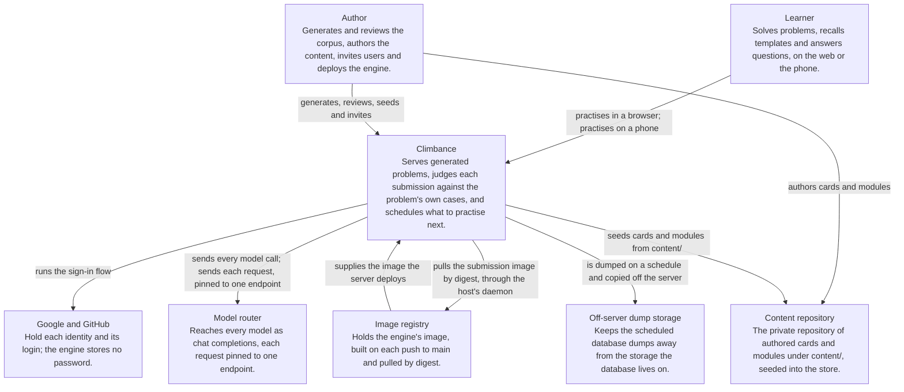
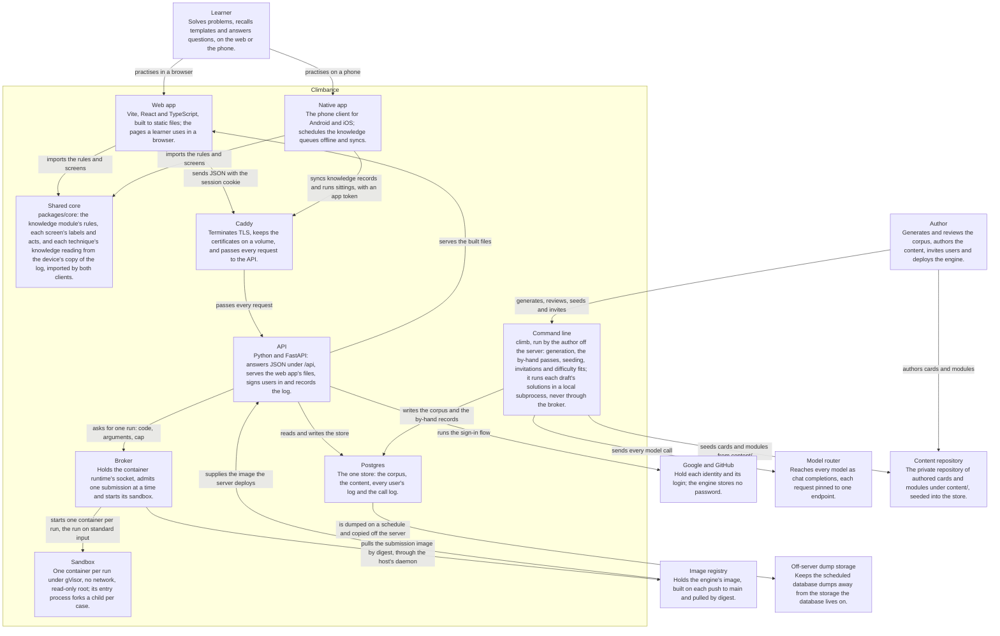
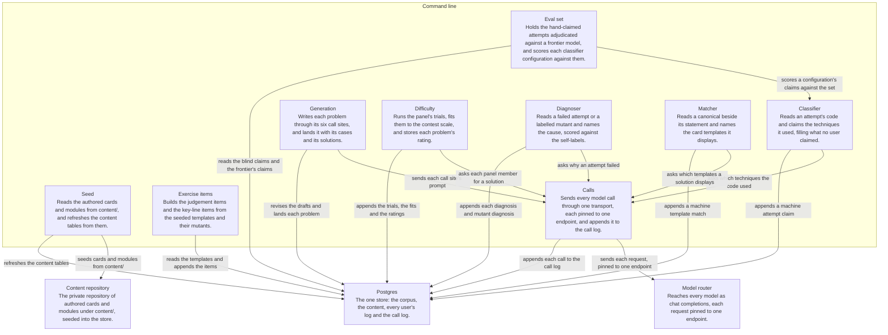

# Architecture

Target state, across this file and the folders beside it. The code lags these
files. On any difference, the doc wins.

<!-- generated from model.toml by `just model-views`, never edited -->

## Views

The engine's context: who uses it and what it reaches outside itself.

The engine's containers: what runs on its own, and what each talks to.

The API's components, and what each reads and writes.

```mermaid
flowchart TB
    identity_providers["Google and GitHub<br/>Hold each identity and its login; the engine stores no password."]
    web_app["Web app<br/>Vite, React and TypeScript, built to static files; the pages a learner uses in a browser."]
    native_app["Native app<br/>The phone client for Android and iOS; schedules the knowledge queues offline and syncs."]
    broker["Broker<br/>Holds the container runtime's socket, admits one submission at a time and starts its sandbox."]
    database["Postgres<br/>The one store: the corpus, the content, every user's log and the call log."]
    subgraph api["API"]
        sitting["Sitting<br/>Times one session on one problem, minted at the first clock press or submission, and ended where next read."]
        submission["Submission<br/>Takes a user's code for a problem, refuses it past the run caps, and mints the attempt carrying the result."]
        runner["Runner<br/>Runs code against a problem's cases, through the broker or the local subprocess, and reads each case's outcome."]
        run_faults["Run faults<br/>Stores a run the sandbox answered no result for, so the run caps count it."]
        attempt_log["Attempt log<br/>Appends each attempt and its attempt verification; private to the user."]
        attempt_claims["Attempt claims<br/>Stores which techniques an attempt's code used, the user's claim standing over the classifier's."]
        self_labels["Self-labels<br/>Stores the user's verdict on why an attempt went the way it did, as a failure mode."]
        template_schedule["Template schedule<br/>Replays each template's FSRS state from its reviews: recall attempts and sittings on problems written for it."]
        card_states["Card states<br/>Derives each card's state, from not started to graduated or lapsed, from the log on every read."]
        mastery["Mastery<br/>Computes each technique's recognition and execution from the log on every read."]
        pick["Pick<br/>Names the next item: a template and the act that reviews it, read from the three folds."]
        predictions["Predictions<br/>Stores what each pick expected, from FSRS and from mastery, before the user acts on it."]
        snapshot["Snapshot<br/>Serves the seeded content to both clients as one document, revalidated by its ETag."]
        knowledge_sync["Knowledge sync<br/>Stores a client's sync lines, refusing each line that names unknown content, and returns the user's records since a cursor."]
        knowledge_log["Knowledge log<br/>The nine append-only tables of the user's knowledge log: answers, stints, focuses and the rest."]
        problems["Problems<br/>Reads a problem from the corpus: its statement, its templates and its test cases."]
        card_runs["Card runs<br/>Stores that a card was started, and the probes the start gave it."]
        recall["Recall<br/>Runs a template typed from memory against the template's cases, and stores the recall attempt."]
        short_exercises["Short exercises<br/>Serves the judgement and key-line items, and stores each judgement and fill."]
        retirement_requests["Retirement requests<br/>Stores a user's request that a problem be retired, for the author to read."]
        feedback["Feedback<br/>Stores a user's note to the author, naming the client and the page."]
        sign_in["Sign-in<br/>Runs the provider flow, refuses an email no invitation holds, and keeps each browser's session."]
        app_tokens["App tokens<br/>Ends the native app's provider flow in a one-time code, and exchanges it for the app's token."]
    end
    sign_in -->|"runs the sign-in flow"| identity_providers
    web_app -->|"starts, pauses and ends the clock"| sitting
    web_app -->|"submits code for the problem"| submission
    submission -->|"mints the sitting where no clock started"| sitting
    submission -->|"runs the code against the problem's cases"| runner
    runner -->|"asks for one run: code, arguments, cap"| broker
    runner -->|"records a run that answered nothing"| run_faults
    submission -->|"counts recent runs against the caps"| run_faults
    submission -->|"appends the attempt and its verification"| attempt_log
    web_app -->|"names the techniques the code used"| attempt_claims
    web_app -->|"says why the attempt went as it did"| self_labels
    template_schedule -->|"replays each sitting's verdict as a review"| attempt_log
    card_states -->|"reads which rungs are solved"| attempt_log
    card_states -->|"reads the recall probability of a spaced check"| template_schedule
    mastery -->|"scores execution per sitting"| attempt_log
    mastery -->|"credits the techniques an attempt used"| attempt_claims
    mastery -->|"reads the failure mode"| self_labels
    web_app -->|"asks for the next item"| pick
    pick -->|"reads each template's FSRS state"| template_schedule
    pick -->|"reads each card's state and next check"| card_states
    pick -->|"reads each technique's mastery"| mastery
    pick -->|"stores what the pick expected"| predictions
    attempt_log -->|"appends to the user's log"| database
    sitting -->|"revises the sitting in place"| database
    predictions -->|"appends each prediction"| database
    attempt_claims -->|"appends each claim"| database
    self_labels -->|"appends each label"| database
    web_app -->|"loads the content"| snapshot
    native_app -->|"loads the content"| snapshot
    web_app -->|"syncs answers and sessions"| knowledge_sync
    native_app -->|"syncs answers and sessions"| knowledge_sync
    knowledge_sync -->|"appends each line"| knowledge_log
    knowledge_log -->|"appends to the user's knowledge log"| database
    snapshot -->|"reads the seeded content"| database
    runner -->|"reads the problem's cases"| problems
    problems -->|"reads the corpus"| database
    web_app -->|"starts a card"| card_runs
    card_runs -->|"appends each card run"| database
    card_states -->|"reads when each run began and its probes"| card_runs
    card_runs -->|"draws the probes from the technique's problems"| problems
    card_runs -->|"reads which problems the user attempted"| attempt_log
    web_app -->|"reads a card's ladder and its state"| card_states
    card_states -->|"reads which rungs a sitting skipped"| sitting
    web_app -->|"types a template from memory"| recall
    recall -->|"runs the typed form against the template's cases"| runner
    recall -->|"appends each recall attempt"| database
    template_schedule -->|"replays each recall attempt as a review"| recall
    web_app -->|"judges a solution; fills a key line"| short_exercises
    short_exercises -->|"appends each judgement and fill"| database
    web_app -->|"asks for a problem's retirement"| retirement_requests
    retirement_requests -->|"appends each request"| database
    web_app -->|"sends a note to the author"| feedback
    feedback -->|"appends each note"| database
    web_app -->|"signs in and out"| sign_in
    native_app -->|"signs in, exchanging a one-time code for a token"| app_tokens
    app_tokens -->|"passes the same provider callback"| sign_in
    sign_in -->|"stores the identities, the invitations and the sessions"| database
    app_tokens -->|"stores each one-time code and app token"| database
```

The Command line's components, and what each reads and writes.

<!-- end of the generated views -->

## Shape

The engine is public and the content is private. Everything the practice loop
reads is local to the engine, which never contacts external platforms.

Consequence: no third-party dependency in the drill loop.

**Problems are the product's own, and the engine writes them.** A statement
scraped from a platform cannot ship, which forces the question of where
problems come from. The answer is a capability of the engine rather than a
licence fix.

**The engine is the platform.** It serves a generated problem, times the
sitting, runs the submission against the problem's own test cases, and records
the verdict. Python only: a canonical is Python, the test cases are
Python-shaped, and a second language is a runner rather than a record change.

**The engine is a learning platform, not a competitive one.** A verdict is
evidence about the user's own practice and ranks the user against nobody. A
solver who games a verdict misleads only their own board. So the drill loop
shows what helps a solver debug, and does not guard a verdict against the
solver.
## Where the rest lives

This file holds the views and the shape of the engine. The files beside it
specify everything else, in a folder per element of `model.toml`. A container
or a system with parts is a folder whose `README.md` holds its own boundary,
and each component is a file named by its id.

| Path | Holds |
|---|---|
| [`model.toml`](model.toml) | The engine's elements as one model: each element's stable id, its role, the doc that specifies it, its relations, and each flow as an ordered list of them. The views above, and each flow's diagram in its page, are generated from it |
| [`concepts/terms/`](concepts/terms/) | Every word this project gives its own meaning, a file per group |
| [`concepts/invariants.md`](concepts/invariants.md) | The properties the system holds at all times |
| [`concepts/repo-constraints.md`](concepts/repo-constraints.md) | How this repo is built, the meta-rule, and the calibration corpus |
| [`concepts/deployment.md`](concepts/deployment.md) | The one server: its storage, the dumps, the journal, the deploy, the secrets and the tunnel |
| [`concepts/machine-records.md`](concepts/machine-records.md) | What a model-written record carries, and content a session writes |
| [`concepts/log-records.md`](concepts/log-records.md) | What every log record carries, one user's log, export and erasure |
| [`concepts/techniques.md`](concepts/techniques.md) | The technique vocabulary and how a technique is claimed |
| [`flows/`](flows/) | The flows crossing containers, a page each with its generated sequence diagram: the drill loop, starting a card run, solving a rung, recalling a template |
| [`api/`](api/README.md) | One origin, JSON writes, client error reports, and a file per component: sign-in, app tokens, the sitting, the submission and its run caps, the runner, the pick and the rest |
| [`cli/`](cli/README.md) | Generation as a command run off the server, and a file or folder per component: generation and its states, difficulty, the classifier, the eval set, the matcher, the diagnoser, the exercise items, the seed and the calls |
| [`broker/`](broker/README.md) | Holding the container runtime's socket, and admitting one run at a time |
| [`sandbox/`](sandbox/README.md) | The container a run happens in, a child per case, and gVisor |
| [`database/`](database/README.md) | The one Postgres store, the data-class table as an index of every record, the tables and the migrations |
| [`proxy/`](proxy/README.md) | Caddy, its certificates and why it serves no files |
| [`content-repo/`](content-repo/README.md) | Cards, the card graph, how a card and a subtopic share a technique, modules, questions, lessons |
| [`core-package/`](core-package/README.md) | The three layers both clients share, the fixtures, every screen of both clients, and the knowledge module's rules |
| [`web-app/`](web-app/README.md) | The structure of the pages, a folder per page with a wireframe per screen, a page's areas, the design system |
| [`native-app/`](native-app/README.md) | The phone client: offline practice, typing code, the editor's measurements |
