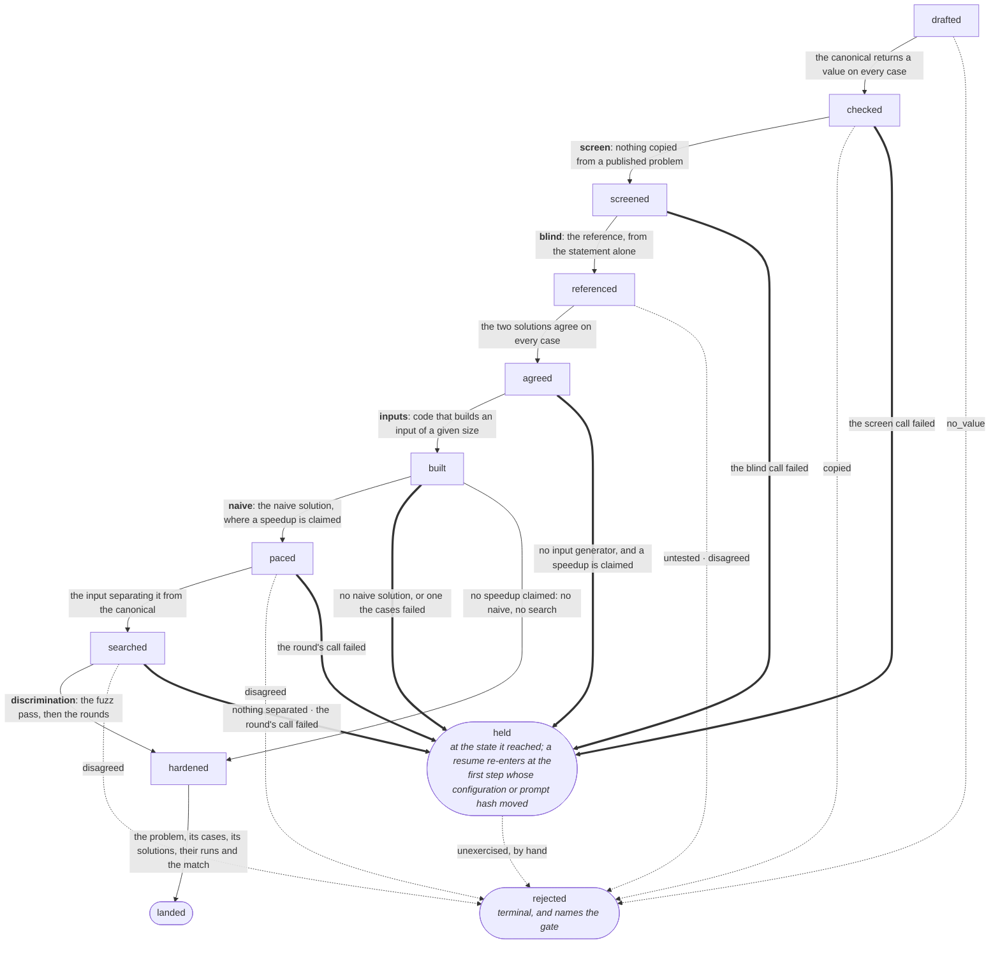

# Writing a problem, as states

The steps in `README.md` `## Generating a problem`, held as durable state. A
draft is stored as it is written, so a step that fails leaves the draft where
it stopped instead of throwing the calls before it away.

The generator is not an edge: a draft exists only once that call answered, and
a second generator call writes a different problem.

## The states

- **Two machines, meeting at landing.** `ProblemStatus` governs a problem that
  exists: created, retired. This machine governs the writing, and its last
  state is `ProblemStatus`'s first.
- **The two machines stay apart.** One enum carrying both would put `drafted`
  beside `retired`, and every reader would have to know which half it was
  looking at.
- **The draft is identified by the writing id.** `SiteOutcome` already mints
  one per writing, so the site records of one draft group with no new
  reference.
- **A state per step that can fail**: drafted, checked, screened, referenced,
  agreed, built, paced, searched, hardened, landed. The names are the steps in
  `README.md`, and the order is theirs.
- **`rejected` is terminal and names the gate that reached it**, which is the
  same `Gate` a site outcome carries. Terminal means no resume rather than no
  record.
- **One gate is a draft's alone.** A held draft rejected by hand names
  `unexercised`: every site answered and none of them was wrong, so there is
  no site outcome to file the gate under. The run never writes `unexercised`,
  since it cannot tell a naive solution that reached the form from an input
  generator that built the wrong shape.

## Where a held draft stops

- **A search that separated nothing stops the draft at `searched`.** The
  search's result is recorded either way, and a held draft leaves by the four
  exits `speedup-search.md` gives.
- **A draft that never reached the search stops earlier.** A speedup is
  claimed and no input generator was written, so the draft is held at
  `agreed` and a resume runs the input generator.
- **A draft with no naive solution stops at `built`.** The naive call failed,
  or the solution it wrote did not pass the problem's cases, and the search
  has nothing to measure the canonical against.
- **A template claiming no speedup goes from `built` to `hardened`.** No
  naive solution is written and no search runs, so the draft never reaches
  `paced` or `searched`, and a failed round holds it at `built`.
- **A loop whose round failed stops the draft before `hardened`**, at whatever
  the steps before it reached. A resume runs the loop over the set as the
  statement left it, which is the set the survivors were decided against.

## What a draft holds

- **A draft holds every output a call produced that no local run re-derives.**
  Those outputs are the statement, the canonical, the declared cases and the
  difficulty, the reference, the settled cases, the input generator's code and
  its bound, the naive solution, the cases the mutation loop appended, and the
  separating case.
- **The mutants and the survivors are not in the draft.** A tree walk
  enumerates them and subprocesses kill them, so a resume re-derives both
  without a call.
- **The loop's counters are not in the draft either.** The counters sit on
  the site outcomes of the same writing id, and a report reads them there.
- **Each step's configuration is copied onto the draft.** The six site
  outcomes are written once the loop has run, so a draft that stopped before
  that has none to read a configuration from.
- **The draft names its target**, as a site outcome and the problem it lands
  as do. A sweep over the store resolves the template from the draft rather
  than from the outcomes of the same writing id.
- **A draft names the problem it landed as.** A crash between landing and
  clearing then leaves a draft the next run can clear, rather than one it
  would write a second time.
- **The draft store is working state rather than a log.** States move and
  records are revised, so the draft store can be refactored where the
  append-only logs cannot.

## Resuming a draft

- **A resume starts at the first step whose configuration or prompt hash
  moved.** The configuration and the prompt hash are both on the draft for
  that reason, rather than only the outputs. A draft where nothing moved
  starts at the step the draft never took.
- **A site is asked again on its own configuration and prompt hash**, as a
  replay skips a pair. The blind and the inputs prompts are the statement
  alone, and the naive site's is the statement, the form to avoid and the
  technique's criterion, so a moved configuration re-pays its own call and no
  other.
- **The steps after the sites read what the sites left.** The search runs the
  input generator against the naive solution, and the loop's survivors are
  decided against a set the reference settled. A site moving takes the steps
  that read it again.
- **The naive site is asked again where the search separated nothing for one
  of two reasons**, though its configuration and its prompt hash stand. The
  naive solution finished at every size (`naive_finished`), or it ran within a
  constant factor of the canonical (`canonical_too_slow`). The naive site is
  the one sampled answering site, so a second call is a second draw. A moved
  bound is read before a second draw, since the search costs subprocesses
  where a draw costs a call.
- **Only those reasons draw again.** A `canonical_too_slow` draft also
  re-walks once a bound moves, as the next bullet gives. A search that never
  ran is the inputs site's to repair. The draft holds the reason, so a resume
  can tell the two apart. The reference is never asked again for this, since
  the search does not measure against it.
- **A draft whose walk stopped at a bound starts at the search once that bound
  moves.** The draft records the ceiling, the canonical's share of the cap,
  the count bound and the search's own revision, and a resume reads the four
  beside the flag and the bench. The revision is bumped where the walk's
  behaviour changes, since a code change moves no bound. A hash of the code is
  not used, because the search spans four modules.
- **A draft held at `searched` starts at the loop once its template drops the
  claim.** The flag is read beside the bench, since a corrected flag moves
  neither a configuration nor a prompt hash.
- **The local steps are taken again either way.** Running the canonical and
  settling the cases cost subprocesses rather than a call, so the draft stores
  neither, and the steps after them need both.
- **A draft's state moves forward only.** The local steps reach states the
  draft passed long ago, and a state moved back would have the next resume
  re-pay the calls this draft already holds.
- **Editing the generator's prompt invalidates no stored draft.** The draft is
  that step's output, and the new prompt writes a different problem rather
  than the same one again.
- **A resumed step writes a second site outcome**, never an amendment, as a
  re-run of any site over one item does.
- **A resume never serves.** Landing is the only transition into `created`,
  and landing still requires every gate the steps in `README.md` require.

## A rejected draft

- **A rejected draft is terminal, and nothing re-runs it.** Its gate says the
  answer was wrong, so a resume skipping that gate would land what the gate
  rejected. The generator's gates leave nothing to ask again but the
  generation call, which writes a different problem. A disagreement is
  evidence that the statement admits two readings, and a second reference is
  a draw against the same prose.
- **A rejected draft is kept for the record.** The gate, the configuration
  behind it and the calls it paid for are readable nowhere else. A report
  over those records says whether a site is rejecting more than it did.
- **Deferred: how long a rejected draft is kept.** The answer needs a corpus
  of drafts.

## The commands

- **A resume is invoked as `generate --resume`**, over every held draft rather
  than one named. A prompt edit reaches the drafts it repairs in one run, and
  the prompt hashes already answer which drafts moved.
- **A resume is aimed at nothing**, as a replay is: the store is the input,
  so the flags that aim a write name no draft.
- **A draft no resume would advance is counted, not run.** Its local steps
  would end where the draft already stands, and the run would then report the
  draft as held again, which says a step was taken. The listing names why the
  draft waits.
- **The store is listed by `generate --drafts`**, each draft named by its
  state, its gate and the step a resume would start at. A sweep is aimed at
  every held draft, and the listing shows the calls a sweep will spend before
  the sweep spends them.
- **A draft no resume would advance is named held**, rather than by the step
  it would start at. A search that stored no case holds the draft before the
  loop, and a resume starting past the search runs no other one.
- **A rejected draft is counted and not listed.** A rejected draft is never
  resumed, so the listing shows exactly the drafts a sweep will reach. The
  count still covers the store, or the summary would report fewer drafts than
  there are, and the listing names how many it held back.
- **One draft is read whole by `generate --draft <id>`**: the statement, both
  solutions, the set the steps settled, and the site outcomes of its writing
  id. A listing is a line per draft, where reading why one stopped needs the
  text its calls produced.
- **A held draft is rejected by hand with `generate --reject <id>`**, and the
  gate it names is `unexercised`. The draft is read whole first, since the
  verdict is that this statement does not exercise the form, and the run
  cannot reach that verdict on its own.
