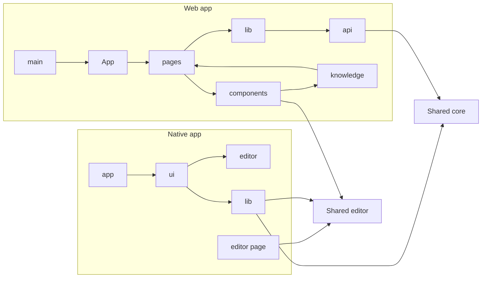

# Client modules

The clients' TypeScript modules and the imports between them, generated by
`just module-graph` from `web/src`, `native/src`, `native/editor`,
`packages/core/src` and `packages/editor/src`. A node is one directory or one
file directly under a workspace's `src`, as `modules.md` draws a package of
`src/climb`. `native/editor` is one node, `editor page`: it is the source that
`just editor-page` bundles into `native/src/editor`. Tests are not drawn.

An arrow runs from a module to a module it imports, type-only imports
included. An import that a chain of drawn arrows already implies is left out.
The clients' imports contain cycles, such as `pages`, `components` and
`knowledge` in the web app. Within a cycle, the arrows are removed one at a
time, so every import stays implied by the arrows that remain. The check, in
pre-commit and in the suite, fails on a stale graph, on an import that
resolves to no file, and on a name the barrel of `packages/core` or
`packages/editor` exports from no file.

The first graph draws the two clients, and each shared package as one node.

<!-- the clients graph, generated by `just module-graph`, never edited -->

<!-- end of the generated clients graph -->

The second graph draws the shared packages per file. Every client imports
`packages/core` through its barrel, `packages/core/src/index.ts`, which
re-exports every file. Each name a client takes through the barrel is drawn as
an import of the file defining that name. A box groups the files that the same
clients reach through imports. A file in a box naming one client sits in a
shared package and is used by that client alone. A file in the box `no client`
is reached by no client's code, and only its tests run it.

```mermaid
flowchart LR
    subgraph g0["Shared core: Native app"]
        core_reminder["reminder"]
    end
    subgraph g1["Shared core: Web app"]
        core_author["author"]
    end
    subgraph g2["Shared core: Web app and Native app"]
        core_account["account"]
        core_answer["answer"]
        core_api["api"]
        core_ask["ask"]
        core_baseline["baseline"]
        core_certs["certs"]
        core_certview["certview"]
        core_claim["claim"]
        core_code["code"]
        core_courses["courses"]
        core_delayed["delayed"]
        core_diagram["diagram"]
        core_engine["engine"]
        core_exam["exam"]
        core_feedback["feedback"]
        core_filling["filling"]
        core_focus["focus"]
        core_forecast["forecast"]
        core_fsrs["fsrs"]
        core_graph["graph"]
        core_guide["guide"]
        core_home["home"]
        core_judging["judging"]
        core_layout["layout"]
        core_learner["learner"]
        core_lessons["lessons"]
        core_lessontext["lessontext"]
        core_listing["listing"]
        core_mapview["mapview"]
        core_modes["modes"]
        core_module["module"]
        core_order["order"]
        core_pairing["pairing"]
        core_practice["practice"]
        core_privacy["privacy"]
        core_queue["queue"]
        core_reading["reading"]
        core_recall["recall"]
        core_records["records"]
        core_reply["reply"]
        core_result["result"]
        core_retirement["retirement"]
        core_run["run"]
        core_schedule["schedule"]
        core_screens["screens"]
        core_sections["sections"]
        core_select["select"]
        core_settings["settings"]
        core_sitting["sitting"]
        core_sittingrun["sittingrun"]
        core_stats["stats"]
        core_sync["sync"]
        core_synced["synced"]
        core_syncstate["syncstate"]
        core_table["table"]
        core_target["target"]
        core_types["types"]
        core_words["words"]
    end
    subgraph g3["Shared editor: Native app"]
        editor_keys["keys"]
        editor_names["names"]
        editor_narrow["narrow"]
    end
    subgraph g4["Shared editor: Web app and Native app"]
        editor_python["python"]
        editor_setup["setup"]
    end
    core_account --> core_sittingrun
    core_answer --> core_result
    core_ask --> core_answer
    core_ask --> core_words
    core_author --> core_api
    core_author --> core_screens
    core_baseline --> core_exam
    core_baseline --> core_words
    core_certs --> core_schedule
    core_certview --> core_order
    core_certview --> core_screens
    core_claim --> core_sitting
    core_courses --> core_types
    core_delayed --> core_exam
    core_delayed --> core_words
    core_engine --> core_api
    core_exam --> core_modes
    core_exam --> core_result
    core_exam --> core_settings
    core_feedback --> core_sittingrun
    core_filling --> core_sittingrun
    core_focus --> core_types
    core_forecast --> core_queue
    core_forecast --> core_words
    core_fsrs --> core_types
    core_home --> core_certview
    core_home --> core_lessons
    core_judging --> core_sittingrun
    core_layout --> core_types
    core_learner --> core_home
    core_lessons --> core_lessontext
    core_lessons --> core_order
    core_lessons --> core_words
    core_lessontext --> core_graph
    core_listing --> core_api
    core_mapview --> core_layout
    core_mapview --> core_module
    core_modes --> core_select
    core_module --> core_screens
    core_module --> core_words
    core_order --> core_types
    core_pairing --> core_api
    core_pairing --> core_lessons
    core_pairing --> core_module
    core_practice --> core_account
    core_practice --> core_lessontext
    core_practice --> core_schedule
    core_queue --> core_focus
    core_queue --> core_select
    core_queue --> core_settings
    core_reading --> core_practice
    core_recall --> core_sittingrun
    core_records --> core_types
    core_reminder --> core_schedule
    core_reply --> core_types
    core_result --> core_lessontext
    core_result --> core_records
    core_result --> core_reply
    core_result --> core_table
    core_retirement --> core_sittingrun
    core_run --> core_baseline
    core_run --> core_delayed
    core_run --> core_screens
    core_run --> core_sync
    core_schedule --> core_courses
    core_schedule --> core_fsrs
    core_screens --> core_queue
    core_select --> core_types
    core_sitting --> core_recall
    core_sitting --> core_words
    core_sittingrun --> core_engine
    core_sittingrun --> core_sitting
    core_stats --> core_schedule
    core_sync --> core_order
    core_sync --> core_queue
    core_sync --> core_records
    core_sync --> core_synced
    core_target --> core_forecast
    core_types --> core_certs
    core_types --> core_diagram
    core_types --> core_graph
    editor_keys --> editor_names
    editor_setup --> editor_python
```

<!-- the shared graph, generated by `just module-graph`, never edited -->

<!-- end of the generated shared graph -->
