# Schema

The tables of the one Postgres store and the foreign keys between them,
generated by `just module-graph` from the tables declared in `src/climb`. The
migrations in `migrations/` are generated from the same declarations. An
integration test fails where the database the migrations build holds another
table or another foreign key than the declarations, so the graph shows the
migrated schema.

Each table sits in the box of the component that owns it, and each component
sits in the box of its container. A component's `tables` in `model.toml` names
the tables it owns. The owner is the component whose doc specifies the table's
record, which is the doc the data-class table in `README.md` links. A table
that other components read or write is drawn once, under its owner.

An arrow runs from a table to a table one of its foreign keys references.
Nearly every table references `users` or `calls`, so no arrow into those two is
drawn. The list below the graph names every foreign key, those two included.
The check fails on a stale graph, on a table no component owns, on a table two
components own, and on a name in `tables` that no table declares.

```mermaid
flowchart LR
    subgraph api["API"]
        subgraph app_tokens_tables["App tokens"]
            app_codes
            app_tokens
        end
        subgraph attempt_claims_tables["Attempt claims"]
            attempt_claims
        end
        subgraph attempt_log_tables["Attempt log"]
            attempt_verification_case_results
            attempt_verifications
            attempts
        end
        subgraph card_runs_tables["Card runs"]
            card_run_probes
            card_runs
        end
        subgraph feedback_tables["Feedback"]
            feedback
        end
        subgraph knowledge_log_tables["Knowledge log"]
            answers
            certification_exams
            focuses
            lesson_marks
            limit_raises
            module_orders
            module_status_changes
            setting_changes
            stints
        end
        subgraph predictions_tables["Predictions"]
            predictions
        end
        subgraph recall_tables["Recall"]
            recall_attempt_case_results
            recall_attempts
        end
        subgraph retirement_requests_tables["Retirement requests"]
            retirement_requests
        end
        subgraph run_faults_tables["Run faults"]
            run_faults
        end
        subgraph self_labels_tables["Self-labels"]
            self_labels
        end
        subgraph short_exercises_tables["Short exercises"]
            fills
            judgements
        end
        subgraph sign_in_tables["Sign-in"]
            identities
            invitations
            sessions
            users
        end
        subgraph sitting_tables["Sitting"]
            sitting_pauses
            sittings
        end
    end
    subgraph cli["Command line"]
        subgraph calls_tables["Calls"]
            calls
        end
        subgraph classifier_tables["Classifier"]
            solution_claims
        end
        subgraph diagnoser_tables["Diagnoser"]
            diagnoses
            mutant_diagnoses
        end
        subgraph difficulty_tables["Difficulty"]
            difficulty_corrections
            difficulty_draws
            difficulty_rating_draws
            difficulty_ratings
            trials
        end
        subgraph exercise_items_tables["Exercise items"]
            judgement_items
            key_line_choices
            key_line_items
        end
        subgraph generation_tables["Generation"]
            draft_declared_cases
            draft_settled_cases
            drafts
            problems
            site_outcomes
            solutions
            test_cases
            verification_case_results
            verifications
        end
        subgraph matcher_tables["Matcher"]
            template_matches
        end
        subgraph seed_tables["Seed"]
            card_requirements
            card_templates
            cards
            diagrams
            lessons
            modules
            questions
            subtopics
            template_cases
            topics
        end
    end
    answers --> questions
    attempt_claims --> attempts
    attempt_verification_case_results --> attempt_verifications
    attempt_verification_case_results --> test_cases
    attempt_verifications --> attempts
    attempts --> problems
    attempts --> sittings
    card_requirements --> card_templates
    card_requirements --> cards
    card_run_probes --> card_runs
    card_run_probes --> problems
    card_runs --> cards
    card_templates --> cards
    certification_exams --> modules
    certification_exams --> topics
    diagnoses --> attempts
    difficulty_draws --> problems
    difficulty_rating_draws --> difficulty_draws
    difficulty_rating_draws --> difficulty_ratings
    difficulty_ratings --> difficulty_corrections
    difficulty_ratings --> problems
    draft_declared_cases --> drafts
    draft_settled_cases --> drafts
    drafts --> card_templates
    drafts --> problems
    fills --> key_line_items
    focuses --> modules
    focuses --> subtopics
    focuses --> topics
    judgement_items --> card_templates
    judgements --> judgement_items
    key_line_choices --> key_line_items
    key_line_items --> card_templates
    lesson_marks --> lessons
    lessons --> modules
    module_status_changes --> modules
    mutant_diagnoses --> card_templates
    predictions --> card_templates
    predictions --> cards
    predictions --> problems
    problems --> card_templates
    questions --> modules
    questions --> subtopics
    recall_attempt_case_results --> recall_attempts
    recall_attempts --> card_templates
    recall_attempts --> cards
    retirement_requests --> problems
    self_labels --> attempts
    site_outcomes --> card_templates
    site_outcomes --> problems
    sitting_pauses --> sittings
    sittings --> problems
    solution_claims --> solutions
    solutions --> problems
    stints --> modules
    stints --> topics
    subtopics --> topics
    template_cases --> card_templates
    template_matches --> card_templates
    template_matches --> solutions
    test_cases --> problems
    topics --> modules
    trials --> problems
    verification_case_results --> test_cases
    verification_case_results --> verifications
    verifications --> solutions
```

<!-- generated by `just module-graph`, never edited -->

| Table | Owner | Foreign keys |
|---|---|---|
| `answers` | Knowledge log | `question_id` → `questions`, `user_id` → `users` |
| `app_codes` | App tokens | `user_id` → `users` |
| `app_tokens` | App tokens | `user_id` → `users` |
| `attempt_claims` | Attempt claims | `attempt_id` → `attempts`, `call_id` → `calls` |
| `attempt_verification_case_results` | Attempt log | `attempt_verification_id` → `attempt_verifications`, `case_id` → `test_cases` |
| `attempt_verifications` | Attempt log | `attempt_id` → `attempts` |
| `attempts` | Attempt log | `problem_id` → `problems`, `sitting_id` → `sittings`, `user_id` → `users` |
| `calls` | Calls |  |
| `card_requirements` | Seed | (`card_id`, `used_by`) → `card_templates`, `card_id` → `cards`, `card` → `cards` |
| `card_run_probes` | Card runs | `card_run_id` → `card_runs`, `problem_id` → `problems` |
| `card_runs` | Card runs | `card_id` → `cards`, `user_id` → `users` |
| `card_templates` | Seed | `card_id` → `cards` |
| `cards` | Seed |  |
| `certification_exams` | Knowledge log | `module_id` → `modules`, `topic_id` → `topics`, `user_id` → `users` |
| `diagnoses` | Diagnoser | `attempt_id` → `attempts`, `call_id` → `calls` |
| `diagrams` | Seed |  |
| `difficulty_corrections` | Difficulty |  |
| `difficulty_draws` | Difficulty | `call_id` → `calls`, `problem_id` → `problems` |
| `difficulty_rating_draws` | Difficulty | `draw_id` → `difficulty_draws`, `rating_id` → `difficulty_ratings` |
| `difficulty_ratings` | Difficulty | `correction_id` → `difficulty_corrections`, `problem_id` → `problems` |
| `draft_declared_cases` | Generation | `draft_id` → `drafts` |
| `draft_settled_cases` | Generation | `call_id` → `calls`, `draft_id` → `drafts` |
| `drafts` | Generation | `blind_call_id` → `calls`, `discrimination_call_id` → `calls`, `generator_call_id` → `calls`, `inputs_call_id` → `calls`, `naive_call_id` → `calls`, `problem_id` → `problems`, `screen_call_id` → `calls`, `target_template_id` → `card_templates` |
| `feedback` | Feedback | `user_id` → `users` |
| `fills` | Short exercises | `item_id` → `key_line_items`, `user_id` → `users` |
| `focuses` | Knowledge log | `module_id` → `modules`, `subtopic_id` → `subtopics`, `topic_id` → `topics`, `user_id` → `users` |
| `identities` | Sign-in | `user_id` → `users` |
| `invitations` | Sign-in |  |
| `judgement_items` | Exercise items | `template_id` → `card_templates` |
| `judgements` | Short exercises | `item_id` → `judgement_items`, `user_id` → `users` |
| `key_line_choices` | Exercise items | `item_id` → `key_line_items` |
| `key_line_items` | Exercise items | `template_id` → `card_templates` |
| `lesson_marks` | Knowledge log | `lesson_id` → `lessons`, `user_id` → `users` |
| `lessons` | Seed | `module_id` → `modules` |
| `limit_raises` | Knowledge log | `user_id` → `users` |
| `module_orders` | Knowledge log | `user_id` → `users` |
| `module_status_changes` | Knowledge log | `module_id` → `modules`, `user_id` → `users` |
| `modules` | Seed |  |
| `mutant_diagnoses` | Diagnoser | `call_id` → `calls`, `template_id` → `card_templates` |
| `predictions` | Predictions | `card_id` → `cards`, `problem_id` → `problems`, `template_id` → `card_templates`, `user_id` → `users` |
| `problems` | Generation | `call_id` → `calls`, `target_template_id` → `card_templates` |
| `questions` | Seed | `module_id` → `modules`, `subtopic_id` → `subtopics` |
| `recall_attempt_case_results` | Recall | `recall_attempt_id` → `recall_attempts` |
| `recall_attempts` | Recall | `card_id` → `cards`, `template_id` → `card_templates`, `user_id` → `users` |
| `retirement_requests` | Retirement requests | `problem_id` → `problems`, `user_id` → `users` |
| `run_faults` | Run faults | `user_id` → `users` |
| `self_labels` | Self-labels | `attempt_id` → `attempts` |
| `sessions` | Sign-in | `user_id` → `users` |
| `setting_changes` | Knowledge log | `user_id` → `users` |
| `site_outcomes` | Generation | `call_id` → `calls`, `problem_id` → `problems`, `target_template_id` → `card_templates` |
| `sitting_pauses` | Sitting | `sitting_id` → `sittings` |
| `sittings` | Sitting | `problem_id` → `problems`, `user_id` → `users` |
| `solution_claims` | Classifier | `call_id` → `calls`, `solution_id` → `solutions` |
| `solutions` | Generation | `call_id` → `calls`, `problem_id` → `problems` |
| `stints` | Knowledge log | `module_id` → `modules`, `topic_id` → `topics`, `user_id` → `users` |
| `subtopics` | Seed | `topic_id` → `topics` |
| `template_cases` | Seed | `template_id` → `card_templates` |
| `template_matches` | Matcher | `call_id` → `calls`, `solution_id` → `solutions`, `template_id` → `card_templates` |
| `test_cases` | Generation | `call_id` → `calls`, `problem_id` → `problems` |
| `topics` | Seed | `module_id` → `modules` |
| `trials` | Difficulty | `call_id` → `calls`, `problem_id` → `problems` |
| `users` | Sign-in |  |
| `verification_case_results` | Generation | `case_id` → `test_cases`, `verification_id` → `verifications` |
| `verifications` | Generation | `solution_id` → `solutions` |

<!-- end of the generated graph -->
