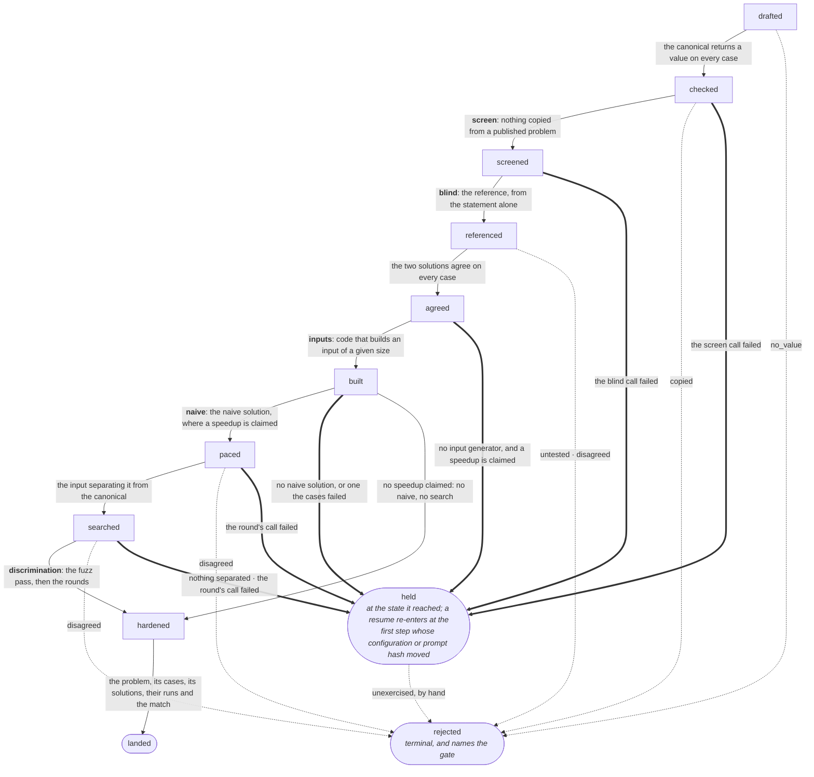

# Flows

Sequences. The other files say what the system holds and where it ends. A
flow says in what order, and what each step may not do.

## Generating a problem

A problem, its test cases and its solutions are written across six calls.
The order matters because each step can reject what came before.

1. The target: a template, naming the form the problem must be solvable by, or
   a technique, naming only the skill. The technique target is deferred, as
   `cli/generation/problem.md` gives.
2. The statement, the canonical solution and the first test cases, from one
   call.
3. The canonical runs, and its outputs are read against the expected values
   the same call declared.
4. A judge reads the statement and the cases for an example, values or
   wording taken from a published problem, and rejects a copied draft.
5. The reference solution, from the statement alone.
6. The reference runs, and the two solutions' outputs are settled: they agree
   on every case, or the draft is rejected.
7. Code that builds an input of a given size and seed, from the statement
   alone.
8. A deliberately naive solution, from the statement and the form it may not
   use, on a template that claims a speedup.
9. The smallest input separating that solution from the canonical under the
   cap is searched for.
10. Mutants of the canonical run against the cases, then against inputs that
   code builds. A call asks for the cases that kill whichever mutant survived
   both, and the ones that killed are appended to the set.
11. The case at the separating size is appended after them.
12. All of it lands together, with the template match the generation asserts
    on its canonical.

- **Problems for one template are written one at a time.** Each call is shown
  the statements the form already has, so two in flight would be shown the same
  list and could write the same problem twice. Concurrency saves minutes and
  costs the diversity the target exists to enforce.
- **A draft lands only once every gate has passed.** A draft failing any step
  stops there, and only one that passed every gate becomes a problem. The
  draft is kept where it stopped rather than deleted, so a fixed step can
  resume from there.
- **The reference is written blind.** Shown the canonical, the reference would
  inherit that solution's reading of the statement. Agreement would then show
  only that one model is consistent. Blind, agreement is evidence that the
  statement has one reading, and disagreement on any case rejects the
  draft.
- **The naive solution is written the opposite way**, and told the form it may
  not use. The naive solution settles no case and rejects no draft, so what
  the naive site is shown cannot reach a verdict.
- **The naive solution stands for the approach the form replaces, at that
  approach's cost.** One trying only the values the input carries has used the
  form's insight, and the search then separates nothing. One trying every
  subset where the statement describes a scan separates at a few dozen
  elements, and a submission of the wrong complexity passes inputs that small.
  The prompt states both ends, since a prompt naming one end produces the
  other fault.
- **A naive solution slower than the plain brute force separates too early.**
  The separating case then admits the brute force, which is slower than the
  form and faster than the naive solution. On 2026-11-16, 14 of the 89 served
  problems with a separating case in the local store had such a naive
  solution. Each of the 14 is cubic where the plain brute force is quadratic.
  The cause is a slice summed, a `min` or a `set` taken per pair, every edge
  scanned again per candidate, or a list searched in place of a set. The 14
  separate between n = 521 and n = 1497, under bounds of 100,000 to 200,000.
  A quadratic solution finishes there within the cap. The conveyor problem,
  `longest-valid-window`, separates at n = 907.
- **A naive solution enumerating every choice is the plain brute force**
  where the statement asks to choose, order or partition. The 11 problems
  separating between n = 10 and n = 65 enumerate subsets, permutations or
  unmemoised recursions, and none of the 11 counts in the 14.
- **The naive site is shown the technique's criterion beside the trigger.** A
  model told to avoid one form reaches the technique through a form no
  template names, as tabulation stands in for a memo.
- **The generator's own expected values are a reading, not a gate.** The call
  that wrote the canonical also declared what each case returns, so the two
  share one reading of the statement, and a contradiction between them is that
  call's arithmetic. A landing case stores the reference's answer. The values
  were a gate once, as `misdeclared`: of ten writings on one template it
  rejected four, and the two checked by hand had the canonical right and the
  declared value wrong. So a mismatch is counted rather than rejected.
- **The count is filed on the generator's own record.** The count says how
  often a configuration's hand-computed value contradicts its own code, which
  is a fact about that site rather than about the problem.
- **The blind reference rejects the draft.** The reference read the statement
  and nothing else, so a disagreement is evidence the prose admits two readings.
  The generator's declaration is evidence about one call.

- **The screen runs before the reference.** A copied draft then costs the
  screen's call alone, rather than the four calls after it.
- **The screen reads the statement and every declared case.** A published
  example reaches a draft as the worked example or as a case's arguments.
- **A retold question is not copied.** A question is free to reuse, and a
  published statement's text and example values are not. An easy problem
  applies a template's form unchanged, so its question is usually a published
  one. The screen rejects reused values and reused wording only.
- **The screen names the published problem it found**, in the site outcome's
  `detail`, so a reader can check the verdict. The record holds the name alone,
  never the published statement.
- **The screen answers from memory, and a miss passes silently.** A model that
  does not remember a published example lets it through. Which configuration
  recalls the most is unmeasured.
- **A copied draft is rejected, not held.** A second generator call writes
  new values, so nothing would re-run this one.
- **The generator is shown what the screen named on its template's earlier
  drafts.** A rejected draft is never stored, so without the list the next call
  receives the same prompt and reproduces the same published example. Each
  `copied` site outcome's `detail` for the template is listed as an example to
  avoid. On the greedy card, nine calls in a row reproduced the published
  examples of Jump Game II, Gas Station and Remove K Digits.
- **The problems already stored are screened by a replay**, `generate --replay
  --only screen`. They landed before the screen existed. A copy the replay
  names is retired by hand, as `copied`.
- **A disagreement is the statement's fault, not either solution's.** Two
  correct-looking solutions returning different answers means the prose admits
  two readings. An in-place edit cannot repair that, since the cases would
  move with the wording.
- **Every run at generation is capped**, well above the drill loop's cap. The
  largest input the reference finishes at decides which cases carry its
  answer, and an uncapped run is a non-terminating reference hanging the run.
- **The scale case is tautological, and harmlessly so.** Correctness was
  established on the cases the reference computed, and the scale case exists
  for the cap rather than for the verdict. The scale case still catches a
  crash or a recursion limit at size. The scale case cannot catch a canonical
  correct small and wrong large.
- **An alternative canonical, where one exists, restores that independence.**
  The alternative canonical is a second efficient solution from a different
  form, so a scale case can be cross-checked between two canonicals rather
  than taken from one. Enumeration produces the alternative canonical, so the
  cross-check is available on a later pass rather than at landing.
- **No model is asked how good the cases are.** A model asked whether its own
  cases suffice says yes. A model asked to break its own solution writes the
  mistakes it expects a solver to make, which is a sample nobody chose and no
  run reproduces. A tree walk enumerates the mutants instead, so the set is
  deterministic and re-derivable, and nothing about the set is stored.
- **A mutant is the canonical with one semantic change**, made on the parsed
  tree rather than the text, so a comparison inside a string is untouched. A
  mutant is killed when it fails at least one case, and a surviving mutant is
  a case that has to exist.
- **A mutant runs under a cap paced by the canonical**, never under the one
  the reference needs. A change that breaks a loop's progress never returns,
  and the solution a mutant has to beat is the canonical it is a copy of.
- **An operator changes one decision the code makes**, and each operator is a
  mistake a solver makes. A mutant nobody would write asks for a case that
  catches nothing. The set of operators is in `climb.mutation`.
- **The call that answers a survivor proposes arguments, never returns.** The
  reference computes what the arguments return, so no model writes an
  expected output that could agree with the mistake the case was asked for.
- **A proposed case that killed nothing does not land.** Every later
  verification runs the stored set, and a case no mutant fails catches nothing
  a case already there does not. Which mutants each proposal killed is read
  from the kill pass the round already pays for, so nothing extra runs.
- **Two proposals killing one mutant land the first.** The second proposal
  decides nothing the set does not already decide, so the order the round
  proposed them in settles which one lands. The fuzz pass keeps its inputs by
  the same rule, building smallest first, so a kept input is the smallest that
  separates.
- **A dropped proposal is still shown to the next round.** The dropped
  proposal is not in the set, and a round shown neither the set nor the
  dropped proposal could propose an input that already killed nothing.
- **The set written with the statement is exempt.** Those cases describe what
  the problem asks rather than what a mutant fails, so they land whether or
  not they kill.
- **A proposed or built input the canonical cannot answer drops the case, not
  the problem.** No check reads an input against the constraints the statement
  gives, so a crash or a timeout on a proposed input is as likely to be an
  input the problem excludes as a defect in the solution. The canonical was
  already run against the cases written with the statement, and those cases
  decide it.
- **A proposed or kept case the two solutions answer differently rejects the
  draft**, as a disagreement on any other case does. The round asks for
  boundary inputs, and the loop exists to find a canonical wrong at a boundary
  the first set never reached.
- **A round that proposes nothing is a verdict, never a failure.** No input
  separates a mutant equivalent to the canonical, and the loop's bound already
  expects such a mutant. A round read as a failed call would hold the draft,
  and every resume would then ask the same question of the same survivors.
- **A round whose call fails holds the draft.** The problem passed every gate
  that judges it, and its set was never measured against the bound. Landing
  the problem would store a set no round was paid for, where a resume asks
  the loop again.
- **The loop stops after two rounds, at one call each, never on a score.** A
  survivor two rounds did not kill is usually equivalent to the canonical, and
  no case kills an equivalent mutant. A round that kills nothing stops the loop
  early. The bound was set before a corpus existed, and how much the second
  round still kills revises it. On the first landings it killed nothing: the
  statement's own cases killed 46 of 53 and 17 of 22 mutants, round one killed
  none of the survivors, and each survivor was equivalent by inspection.
- **The search runs before the loop and its case is appended after the
  loop.** The survivors are decided against the set as the statement left it,
  so the separating case may not join that set. Searching first catches a
  canonical wrong at scale before a round is paid for.
- **The naive solution is written after the input generator.** The input
  generator is written for every problem, since the fuzz pass builds with it,
  and the naive solution only where a speedup is claimed.
- **The separating case is settled as any other case.** The reference is
  measured well above the sitting's cap, so it usually computes the value the
  separating case stores. A disagreement on the separating case rejects the
  draft, and that disagreement catches a canonical correct on the small
  cases and wrong at scale.
- **The input the search measured is the input the case stores.** The input
  generator is asked to build one input per size, and building the input
  again would be a second run of model-written code.
- **The input generator is written for every problem**, whatever the target
  named, and before the mutation loop. The fuzz pass kills mutants with the
  inputs the input generator builds, so a round is paid for the survivors
  alone.
- **The fuzz pass runs only where a mutant is standing.** A case set that
  already kills every mutant builds nothing, so a problem the statement's
  own cases decide costs no execution here.
- **A round is shown what the pass kept.** Those cases are in the set the
  survivors were decided against, so re-proposing one would win a case that
  kills nothing.
- **The canonical is the oracle for killing, and the reference settles the
  case.** A mutant is killed by answering a built input differently from the
  canonical, which needs no expected value. The reference runs on the kept
  inputs alone.
- **A kept input is shrunk before it is stored.** The mistake it catches
  usually needs a few elements, and every later verification saves the
  difference. The shrink keeps every mutant that input killed, and shortens
  lists alone, since a smaller number may break the statement's constraints.
  It runs on a budget of candidates, each costing a run per mutant.
- **The shrunk input is answered again, and weighed after the shrink.** The
  canonical computes its answer, and an input over the ceiling may fit once it
  is only as large as the kill needs.
- **A search that fails holds the draft, as one that separated nothing does.**
  The input generator's code can crash, which says nothing about the
  statement. The case a landing needs is missing, and the run reports what
  the search stopped at.
- **A call that wrote no input generator holds the draft too**, where a speedup
  is claimed. No search ran, so the claim is undemonstrated for the same reason,
  and a resume starts at the input generator rather than at the search. The
  missing input generator costs the fuzz pass besides.
- **A search that stored no case names its reason, and the reasons assert
  different things.** `Missing` in `speedup.py` holds each one.
  - `case_too_large`: a separating size was found and the case at it weighs
    over the ceiling. The speedup is established, and the run reports the
    size and both timings.
  - `naive_finished`: the naive solution finished at the statement's largest
    input. The search has established nothing.
  - `count_too_large`: the naive solution finished at the largest storable
    input, and the repeat count reaching the cap is over its bound. A
    separation may still sit above either bound.
  - `canonical_too_slow`: the canonical took over a tenth of the cap where
    the naive solution exceeded it. The two are within a constant factor, and
    no count separates them.
  - `naive_crashed`, `canonical_failed` and `disagreed`: a solution crashed,
    failed, or the two disagreed at a size the walk reached.
  - `input_too_large`: no storable input separated. Only drafts written
    before the repeat count carry it.
- **The walk bisects up to the ceiling first**, since a quadratic naive
  solution often separates within the last factor of two.
- **A naive solution finishing at the largest legal input is a defect in the
  run, not in the problem.** The naive solution reached the form, the input
  generator built a shape the form does not beat, or the template claims a
  speedup it lacks. The run cannot tell the three apart.
- **Such a draft is held, not rejected.** The statement, the cases and every
  solution passed every gate that judges them. Rejecting would keep only the
  problems one model happened to be slow at.
- **A held draft leaves by one of four exits.** A resumed search separates it,
  a second naive draw is slow, the template's `speedup` is corrected and the
  search is skipped, or the draft is rejected by hand as `unexercised`. A naive
  solution writing the form it was told to avoid is the strongest evidence the
  problem does not exercise the form.
- **The naive solution has to be correct on every case it answers**, and a
  naive solution that is not holds the draft. A case it does not finish is no
  failure, since being slow is its purpose. A naive solution that is wrong
  measures nothing, so a search against it would separate on a mistake rather
  than on the form.
- **A wrong naive solution rejects nothing all the same.** The naive solution
  is the solution the search times rather than a reading of the statement. A
  wrong naive solution establishes that this solution cannot serve, and
  nothing about the problem.
- **A landed problem is never repaired.** A stored problem carries attempts
  and its cases are append-only, so every fix is a resumed draft. A step that
  has no answer therefore stops the writing rather than lowering what a
  landing requires.
- **Every step's verdict is recorded, not only reported.** A run prints each
  stage and the process then ends, so a rejected draft would leave only the
  calls it paid for. `cli/generation/site-outcomes.md` gives what a site's
  record carries.
- **A run ends on what it reached, and prints no statement.** Each problem
  the run stored is a line naming the id, and `climb problem <id>` reads
  one problem whole. Ten statements scroll the result out of the terminal.
- **The first problem written for a template is the standard problem its
  form is known by.** A learner meets the form first on the question it is
  usually taught with. Many learners have not met that question, and the
  later problems for the template train recognition. Each later problem asks a
  question the earlier ones do not, in any setting, the trigger's own
  included.
- **Failing means two things on the cases written with the statement.** The
  first canonical is run before any expected value is settled, so it fails
  only by yielding no value on some case, and the draft is rejected. A
  later canonical is judged by the cases the problem carries, so it fails as
  any solution does, and nothing is rejected.

## Writing a problem, as states

The sequence above, held as durable state. A draft is stored as it is written,
so a step that fails leaves the draft where it stopped instead of throwing the
calls before it away.

The generator is not an edge: a draft exists only once that call answered, and
a second generator call writes a different problem.

- **Two machines, meeting at landing.** `ProblemStatus` governs a problem that
  exists: created, retired. This machine governs the writing, and its
  last state is `ProblemStatus`'s first.
- **The two machines stay apart.** One enum carrying both would put `drafted`
  beside `retired`, and every reader would have to know which half it was
  looking at.
- **The draft is identified by the writing id.** `SiteOutcome` already mints
  one per writing, so the site records of one draft group with no new
  reference.
- **A state per step that can fail**: drafted, checked, screened, referenced,
  agreed, built, paced, searched, hardened, landed. The names are the steps
  above and the order is theirs.
- **A search that separated nothing stops the draft at `searched`.** The
  search's result is recorded either way, and a held draft leaves by the four
  exits above.
- **A draft that never reached the search stops earlier.** A speedup is
  claimed and no input generator was written, so the draft is held at
  `agreed` and a resume runs the input generator.
- **A draft with no naive solution stops at `built`.** The naive call failed,
  or the solution it wrote did not pass the problem's cases, and the search
  has nothing to measure the canonical against.
- **A template claiming no speedup goes from `built` to `hardened`.** No
  naive solution is written and no search runs, so the draft never reaches
  `paced` or `searched`, and a failed round holds it at `built`.
- **A loop whose round failed stops the draft before `hardened`**, at whatever
  the steps before it reached. A resume runs the loop over the set as the
  statement left it, which is the set the survivors were decided against.
- **`rejected` is terminal and names the gate that reached it**, which is the
  same `Gate` a site outcome carries. Terminal means no resume rather than
  no record.
- **One gate is a draft's alone.** A held draft rejected by hand names
  `unexercised`: every site answered and none of them was wrong, so there is
  no site outcome to file the gate under. The run never writes `unexercised`,
  since it cannot tell a naive solution that reached the form from an input
  generator that built the wrong shape.
- **A draft holds every output a call produced that no local run re-derives.**
  Those outputs are the statement, the canonical, the declared cases and the
  difficulty, the reference, the settled cases, the input generator's code and
  its bound, the naive solution, the cases the mutation loop appended, and the
  separating case.
- **The mutants and the survivors are not in the draft.** A tree walk
  enumerates them and subprocesses kill them, so a resume re-derives both
  without a call.
- **The loop's counters are not in the draft either.** The counters sit on
  the site outcomes of the same writing id, and a report reads them there.
- **Each step's configuration is copied onto the draft.** The six site
  outcomes are written once the loop has run, so a draft that stopped before
  that has none to read a configuration from.
- **A resume starts at the first step whose configuration or prompt hash
  moved.** The configuration and the prompt hash are both on the draft for that
  reason, rather than only the outputs. A draft where nothing moved starts at
  the step the draft never took.
- **A site is asked again on its own configuration and prompt hash**, as a
  replay skips a pair. The blind and the inputs prompts are the statement alone,
  and the naive site's is the statement, the form to avoid and the technique's
  criterion, so a moved
  configuration re-pays its own call and no other.
- **The steps after the sites read what the sites left.** The search runs the
  input generator against the naive solution, and the loop's survivors are
  decided against a set the reference settled. A site moving takes the steps
  that read it again.
- **The naive site is asked again where the search separated nothing for one
  of two reasons**, though its configuration and its prompt hash stand. The
  naive solution finished at every size (`naive_finished`), or it ran within a
  constant factor of the canonical (`canonical_too_slow`). The naive site is
  the one sampled answering site, so a second call is a second draw. A moved
  bound is read before a second draw, since the search costs subprocesses
  where a draw costs a call.
- **Only those reasons draw again.** A `canonical_too_slow` draft also
  re-walks once a bound moves, as the next bullet gives. A search that never
  ran is the inputs site's to repair. The draft holds the reason, so a resume
  can tell the two apart. The reference is never asked again for this, since
  the search does not measure against it.
- **A draft whose walk stopped at a bound starts at the search once that bound
  moves.** The draft records the ceiling, the canonical's share of the cap, the
  count bound and the search's own revision, and a resume reads the four beside
  the flag and the bench. The revision is bumped where the walk's behaviour
  changes, since a code change moves no bound. A hash of the code is not used,
  because the search spans four modules.
- **The local steps are taken again either way.** Running the canonical and
  settling the cases cost subprocesses rather than a call, so the draft stores
  neither, and the steps after them need both.
- **A draft's state moves forward only.** The local steps reach states the
  draft passed long ago, and a state moved back would have the next resume
  re-pay the calls this draft already holds.
- **A draft held at `searched` starts at the loop once its template drops the
  claim.** The flag is read beside the bench, since a corrected flag moves
  neither a configuration nor a prompt hash.
- **The draft names its target**, as a site outcome and the problem it lands
  as do. A sweep over the store resolves the template from the draft rather
  than from the outcomes of the same writing id.
- **Editing the generator's prompt invalidates no stored draft.** The draft is
  that step's output, and the new prompt writes a different problem rather
  than the same one again.
- **A resumed step writes a second site outcome**, never an amendment, as a
  re-run of any site over one item does.
- **A resume never serves.** Landing is the only transition into `created`,
  and landing still requires every gate this flow requires.
- **A rejected draft is terminal, and nothing re-runs it.** Its gate says the
  answer was wrong, so a resume skipping that gate would land what the gate
  rejected. The generator's gates leave nothing to ask again but the
  generation call, which writes a different problem. A disagreement is
  evidence that the statement admits two readings, and a second reference is
  a draw against the same prose.
- **A rejected draft is kept for the record.** The gate, the configuration
  behind it and the calls it paid for are readable nowhere else. A report
  over those records says whether a site is rejecting more than it did.
- **The draft store is working state rather than a log.** States move and
  records are revised, so the draft store can be refactored where the
  append-only logs cannot.
- **A draft names the problem it landed as.** A crash between landing and
  clearing then leaves a draft the next run can clear, rather than one it
  would write a second time.
- **A resume is invoked as `generate --resume`**, over every held draft rather
  than one named. A prompt edit reaches the drafts it repairs in one run, and
  the prompt hashes already answer which drafts moved.
- **A draft no resume would advance is counted, not run.** Its local steps
  would end where the draft already stands, and the run would then report the
  draft as held again, which says a step was taken. The listing names why the
  draft waits.
- **A resume is aimed at nothing**, as a replay is: the store is the input,
  so the flags that aim a write name no draft.
- **The store is listed by `generate --drafts`**, each draft named by its
  state, its gate and the step a resume would start at. A sweep is aimed at
  every held draft, and the listing shows the calls a sweep will spend before
  the sweep spends them.
- **A draft no resume would advance is named held**, rather than by the step
  it would start at. A search that stored no case holds the draft before the
  loop, and a resume starting past the search runs no other one.
- **One draft is read whole by `generate --draft <id>`**: the statement, both
  solutions, the set the steps settled, and the site outcomes of its writing
  id. A listing is a line per draft, where reading why one stopped needs the
  text its calls produced.
- **A held draft is rejected by hand with `generate --reject <id>`**, and the
  gate it names is `unexercised`. The draft is read whole first, since the
  verdict is that this statement does not exercise the form, and the run
  cannot reach that verdict on its own.
- **A rejected draft is counted and not listed.** A rejected draft is never
  resumed, so the listing shows exactly the drafts a sweep will reach. The
  count still covers the store, or the summary would report fewer drafts than
  there are, and the listing names how many it held back.
- **Deferred: how long a rejected draft is kept.** The answer needs a corpus
  of drafts.

## Enumerating a problem's other solutions

Deferred until a ladder needs a second canonical for the matcher to read, as
`cli/generation/solutions.md` gives. No code runs the steps below yet.

A landed problem carries one canonical, written for what its target named. Every
other way to solve it is found afterwards, over the stored problem.

1. The statement, the cases it carries and the canonical it already has.
2. A call proposes the approaches that solve it, each as a name and a one-line
   idea.
3. A canonical is generated per approach, one call each.
4. Each runs against the cases the problem already carries, and one that fails
   is not stored.
5. Each stored canonical is read for its techniques and for the templates it
   displays.

- **Enumeration runs over the corpus, never in the landing path.** A proposal
  nobody could write says nothing about the statement, so enumeration cannot
  gate a problem. The list needs no gate of its own either: its length tracks
  the model's verbosity, and a wrong proposal costs one call and lands
  nothing.
- **One call per approach, never one reply carrying all of them.** A single
  bad entry would otherwise fail the whole batch, where each canonical is
  judged on its own.
- **The proposing call sees the first canonical.** Independence is the
  reference's purpose rather than this call's. This call is asked for
  approaches that differ from what is stored, and that needs the stored
  canonical in view.
- **A canonical enumeration produced is not a reference.** The enumerated
  canonical saw the statement, the cases and another solution, so it is no
  independent reading. The enumerated canonical cannot reject a draft, and
  its failure says nothing about the statement.
- **Execution cannot catch duplicates.** Top-down and bottom-up dynamic
  programming pass the same cases, and only a template match separates them.
  The
  handling of two canonicals of one form is deferred until a corpus shows how
  often it happens.

## Replaying a site

The five answering sites over a stored problem, at a configuration the corpus
has not been read by. Generation writes a new problem every call, so nothing
there is ever asked twice and no two configurations meet the same item.

1. The stored problems, minus the retired ones and any missing a solution in
   either role.
2. Per site, the prompt hash it would send now. A pair this configuration has
   answered at that prompt hash is skipped.
3. The screen site judges the statement for copied material.
4. The blind site writes a reference from the statement, settled against the
   cases the problem carries rather than against the canonical.
5. The discrimination site runs the mutation loop over the stored canonical,
   against the set as it stood before the rounds: the statement's cases and
   the kept fuzz inputs. No fuzz pass runs.
6. The inputs site builds an input generator, where the template claims a
   speedup, and the search measures it against the stored naive solution.
   The naive site then writes a naive solution, judged against the cases.
7. Each site's answer is recorded as its outcome, keyed to the problem.

- **`--only` narrows a replay to the sites it names.** Screening the corpus
  would otherwise pay every other site's call too.
- **A replay writes nothing to the corpus.** A case a round wins here is
  dropped, or the next configuration would be measured against a different
  problem.
- **The loop is replayed against the set as it stood.** A case a later round won
  and the separating case are excluded, since neither was there when the
  survivors were decided. Counting them changes the survivors and the prompt
  hash, and the generation run's own record would then answer for nothing.
- **The discrimination prompt hash is known only after the local kill pass.**
  The survivors are in the prompt, and killing costs subprocesses rather than a
  call, so the skip is decided after that pass and before the call.
- **A retired problem is not replayed.** A defective one was never a fair test,
  and a later corpus will not hold it.
- **The inputs site is asked only where a speedup is claimed**, where the
  landing path builds for every problem. A replay records the verdict a gate
  reached on an answer, and nothing here runs the code the call wrote unless
  a search does.
- **The naive site is asked there too**, where a speedup is claimed. The
  naive site's record carries the configuration and whether the solution it
  wrote answers the problem's cases, since a wrong naive solution rejects no
  draft and so names no gate.
- **The search stays measured against the stored naive solution**, not the one
  this run just wrote. Moving the input generator and the naive solution
  together would leave neither configuration readable from the verdict.

## Drill loop

Practice on a generated problem. The engine serves the statement, times the
sitting and judges the submission, and records what only the user can say.

The page layout is not designed here, and using the loop decides it.

1. The board, ordered by staleness. The user picks a technique. The
   technique's cards are linked from this step on.
2. Candidates for the technique, least recently attempted first, lowest solve
   rate breaking a tie. The user picks one.
3. Opening the problem serves its statement and mints nothing. The clock
   starts on the user's press, or at once where the clock preference is on,
   and the clock's start mints the sitting.
4. The submission runs against the problem's own test cases, and the attempt is
   minted carrying the result. A submission where no clock started mints the
   sitting first.
5. Keyed to each attempt, the loop asks for an attempt claim and then for a
   self-label, and one press stores both.

- **The board offers every technique a served problem carries**, practised or
  not, and a technique never practised ranks stalest. A board of practised
  techniques alone opens the first sitting with nothing to pick.
- **A candidate is offered without its statement.** Opening the problem is
  the act that serves the statement, so the list stays a list of picks.
- **No press stands between the pick and the statement.** A press that started
  the clock before the statement was shown made opening a problem a commitment,
  and the author avoided opening problems because of it.
- **Opening a problem records nothing.** `api/sitting.md` gives why the sitting
  waits for the first clock press or the first submission. A user can then read
  any number of statements before choosing one to solve.
- **The clock is shown, and the user starts it.** The clock does not run until
  the user presses start. A sitting whose clock never ran is untimed, and that
  is a legitimate way to practise.
- **The clock preference decides whether the next clock starts by itself.**
  The user's last press sets it: starting or resuming a clock turns it on, and
  pausing one turns it off. It is off until the user first starts a
  clock. The automatic pause on a hidden page sets nothing,
  or one tab switch would stop every later clock unnoticed.
- **The clock measures from its own start.** Reading done before the press is
  not counted, and the attempt carries the time the clock ran.
- **The card is offered, and no sitting requires it.** A user who holds the
  form solves straight away, and a user who does not reads the card first.
  Recognising a form with no card in view is a probe's test.
- **A sitting ends at the End press or at the idle bound `api/sitting.md`
  gives.** A user who started a clock and left the page has nothing to close,
  and mastery reads nothing from a sitting with no submission.
- **A solved sitting takes further submissions.** A user who solved by brute
  force submits the better form in the same sitting. Ending the sitting at the
  solve split one session on one problem into two sittings. The second was
  solved on its first submission, so it counted as a second review and a
  second execution score of 1 at the same moment.
- **A sitting's verdict is read through its first solve.** The rating and the
  execution score read the attempts up to the first solve and no further. A
  later attempt that fails, on a form the user is trying, then leaves the
  verdict as it was.
- **An attempt nobody timed stays untimed**, rather than carrying a duration
  reconstructed after the fact.
- **A running clock is paused and resumed**, and the elapsed time the attempt
  carries excludes every pause. `api/sitting.md` gives what the record holds. A
  pause and a stop are one press: a paused clock stays paused until the user
  resumes it.
- **A paused clock leaves the page usable, and a submission is still taken.**
  A pause stops the timing, not the practice. The attempt carries the time the
  clock ran before the pause.
- **A hidden page pauses a running clock, and the page returning resumes it.**
  The clock counts the time on the problem, and a solver who left the tab is
  away from it. A clock the user paused stays paused when the page returns,
  since the page resumes only the pause hiding it started.
- **The editor proposes no name from the standard library.** The editor a
  sitting is typed into highlights syntax and indents. A solver offered
  `bisect_left` after three characters has recalled no form, and the sitting
  exists to measure recalling the form. The recall trainer holds
  the same rule.
- **The phone's keyboard offers the names the file already declares.** A
  variable, a parameter or a function the solver wrote is the solver's own
  word, and offering it back recalls no form. Retyping `nums` and `prefix`
  is the largest cost left on a phone's keys, where a physical keyboard
  makes it cheap. A name the file only imports is offered too, since typing
  the import was the recall.
- **The editor pairs a bracket or a quote as it is typed**, on the web and
  the phone alike. A closing bracket names nothing, so the pair recalls
  nothing for the solver, and the two editors then behave as one.
- **The editor opens on the user's latest code for the problem, where that code
  is work in progress.** The latest code is the newer of the unsent draft the
  browser holds and the code of the last attempt the engine stored. Reopening a
  half-solved problem continues it, where a blank file would cost the work.
- **Code from a solve is never carried.** The editor opens on the signature
  when the user's last attempt on the problem solved it. Prefilling an answer
  turns a re-solve into reading it, and nothing is then retrieved.
- **Code from before a card run is never carried into that run's problems.** A
  problem opened from a card with a run open carries only code written after
  the run began. The run measures solving from its start, as `api/card-runs.md`
  gives.
- **A press restores the user's last solve into the editor.** The press is
  offered where the user has solved the problem before and the editor did not
  carry that code. The editor's undo takes the restore back.
- **An attempt made after a restore says so.** The attempt carries `restored`,
  and mastery does not count it as a solve. A solve typed over a restored solve
  is not an independent solve, as a hinted recall pass is not a pass.
- **A failing submission shows the first case it failed, whole**: the
  arguments, the expected value, and the value the submission returned or the
  exception it raised. An outcome on an input the solver cannot see is debugged
  by guessing, and guessing at an input is not the skill a sitting measures.
- **The first case is first in the order the problem carries its cases.** The
  cases written with the statement come before the mutation loop's and the
  separating case, so a small example is shown where one fails.
- **The case is shown whatever its size.** A trimmed input is an input the
  submission never failed on.
- **A shown case can be special-cased, and nothing guards against it.** A
  solver can patch one input per submission until every case passes.
  `README.md` gives why the loop does not guard a verdict. Each submission
  mints an attempt, so the patching stays readable in the log.
- **A drill can mint several attempts**, and each is asked about in turn. A
  submission that failed on syntax and the one that passed are different
  evidence, and labelling only the last would leave the counts on two
  denominators: attempts per submission, labels per sitting.
- **The label and the claim are cheap only here.** The candidates are the
  problem's own two or three techniques, the drilled one is the default since
  selection picked the problem by it, and the attempt is minutes old. Two facts
  a classifier has to infer later cost a keystroke each at this moment.
- **The claim is asked before the label.** The claim asks which techniques the
  code used, and naming them puts the approach the solver took into words. The
  label then asks whether the solver held that approach, which is the question
  the claim has just framed.
- **One press stores the claim and the label.** The two answer one attempt, so
  a press each would have the solver confirm the same attempt twice.
  `wireframes.md` draws the overlay the two are asked in.
- **A skipped label stops nothing.** The loop moves to the next attempt of the
  sitting, and the attempt stays unlabelled. `api/self-labels.md` gives what a
  skip leaves.
- **The loop does not retire a problem.** A statement that asks for something
  its cases do not decide is retired by hand, in the terminal, and
  `api/problems.md` gives who retires one. A sitting can send a retirement
  request from under the statement, and the request retires nothing until the
  author acts on it, as `api/retirement-requests.md` gives. A self-label
  written before the retirement stays, and the board's read-time exclusion
  keeps that attempt out of mastery.
- **Selection never schedules.** Ordering is a view. The user chooses what to
  drill until the scheduler lands.

## Starting a card run

Studying a card is an explicit act. The user opens a card, reads it, and starts
a run when they mean to study the technique. The ladder is measured from that
start, and the probes are drawn at it.

1. The card, opened from the Cards section or from a technique's page. The
   trigger, the brief and the templates read whether or not a run is open.
2. The user starts the run.
3. A `CardRun` is minted, carrying when the run began.
4. The probes are drawn from the corpus and stored on the run: a problem the
   card's technique carries, unseen first, then least recently attempted, and
   never one the ladder holds.
5. The card then shows its ladder, its templates with their recall state, and
   the probes the run was given.

- **A run is minted rather than inferred from an attempt.** A ladder problem
  solved before the card began does not count toward the ladder, and only a
  stored start says which attempts came after it.
- **The card reads the same before the start and after it.** The trigger, the
  brief and the templates are the study material, and withholding them until a
  run opens would make starting a run the price of reading the card.
- **The ladder is shown before a run opens.** The ladder names the problems
  studying this card will have the user solve, and the user decides the start on
  that list. Progress against the ladder is shown once a run measures it.
- **A locked card does not start.** The card reads in full, and the press
  starting the run names the required cards not yet met. `api/card-states.md`
  gives when a card is locked and how a user who holds the forms meets a
  required card.
- **A card with a gap still starts.** A core template no solution displays is
  reported on the card, as `content-repo/cards.md` requires, and the rungs
  the ladder does hold are still worth solving. Refusing the start would
  leave the user waiting on a problem nobody has written yet.
- **The probes are drawn at the start, and never at import.** A problem unseen
  at import need not still be unseen when the user starts the card, and a probe
  the user has already solved tests no recognition.
- **The draw is a rule, and no model chooses a probe.** The rule reads the
  technique's problems, unseen first, then least recently attempted. A model
  asked to choose would answer the question the rule already answers, and it
  would answer it differently each time the same card was started.
- **The draw reads the technique rather than the selector's filters.** The
  filters narrow what the ladder teaches, and a probe asks whether the
  technique is recognised at all.
- **Whether a statement gives its own form away is not read here.** A statement
  naming its approach is a property of the corpus rather than of the pick, and
  its measurement is deferred.
- **A probe is stored on the run, not derived.** The draw reads the attempt log
  as it stood at the start, so a later attempt would change what a re-derivation
  returned. The probes the run offered have to stay readable.
- **Later probes append.** A run given another probe keeps the ones it was given
  first, so what was offered and when stays readable.
- **A probe opens the problem page a rung opens**, named by the card it came
  from. "Solving a rung" gives that page.
- **The run holds no verdict.** Ladder progress, the recall state of each
  template, and the card state are folds over the attempts, the recall attempts
  and the corpus. `api/card-states.md` gives why none of the three is stored.
- **A card is done once it graduates.** `api/card-states.md` gives the five
  card states and what each one reads.

Deferred, since only use answers each:

- How many probes a start draws.
- When a run is given a further probe, and what asks for one.
- Whether a card can be started again, and what a second run means for a ladder
  the first run already measures.

## Solving a rung

The card has the user solve problems, and each of them is a rung of its ladder.
The rung is picked on the card, sat as any problem is, and the sitting returns
to the card it came from.

1. The ladder on the card: a rung per problem, each naming the templates it
   covers and whether it is required.
2. The user picks a rung.
3. The problem opens, named by the card the pick came from, and serves the
   statement as the drill loop gives.
4. The submission, the verdict and the claim run as the drill loop gives them.
5. The solve stays on the page, with a press back to the card, where the next
   rung is.

- **The ladder follows the card's own template order.** A card authors its
  templates in the order it teaches them, and a rung covering the first template
  comes before a rung covering the third. The rungs the selector fills the
  ladder out with follow, least recently attempted first, as a technique's
  candidates are ordered. The ladder's first easy rung comes before all of
  them, as `content-repo/cards.md` gives.
- **A rung names the templates it covers**, so the user reads why this problem
  is on this ladder. The templates also decide whether the rung is required,
  which `content-repo/cards.md` derives rather than stores.
- **A rung carries no statement**, as a candidate carries none. Opening the
  rung serves the statement, so the ladder stays a list of picks.
- **The problem's page is the one a technique's candidates open.** A rung is a
  problem, and a second page for the same record would serve the same statement
  under another URL.
- **The page names the card rather than a technique**, since the user came from
  the card. The way back returns to the card, and the claim answers for the
  card's own technique.
- **A sitting offers a press back to the card, and a solved one stays on the
  page.** A user reads a solve back after it passes, so the page does not leave
  by itself. A user solving a ladder is working through a list, and the press
  returns to the card rather than to the board.
- **Progress is a fold over attempts, never a mark on a rung.** A rung is solved
  where an attempt on its problem, finished after the run began, was solved. The
  rung carries no mark, so a ladder re-derived under a moved corpus keeps every
  rung the user already solved.
- **An attempt reached from the board counts too.** The fold reads the attempts
  on the rung's problem, whichever page served them, since the ladder measures
  solving rather than the route taken to it.
- **An attempt finished before the run began counts for nothing.** Having solved
  the problem once is not having studied the form. The run is minted to draw
  that line.
- **A rung is skipped where its last sitting since the run began ended with no
  submission**, by the End press or the idle bound. The skip is read from the
  sitting store, so no record marks it. An End press and an idle sitting count
  alike, since the store cannot tell a give-up from an interruption.
- **A skipped rung is served after the rungs not skipped.** The skipped
  problem gives way on the ladder to another problem covering the same
  templates, if one exists. Otherwise the rung keeps its problem and comes back
  once the rungs after it are solved or skipped.
- **A skip counts for nothing else.** Mastery reads nothing from a sitting with
  no submission, and FSRS rates no review from it, as `## A template's
  reviews` gives.
- **A retired problem fills no rung**, and the ladder is re-derived.
  `content-repo/cards.md` gives both, and the attempts on the retired problem
  stay in the log.

Deferred, since only use answers each:

- Whether the ladder is extended while a run is open, and what asks for more
  rungs.
- The card's reading where a required rung's problem was retired and no problem
  replaces it.

## Recalling a template

A form reproduced from memory, typed into a blank file and run against the
cases the template carries. Reading the form is not recalling it, so the
trainer never prints the form until the user asks for it as a hint.

1. The user starts a recall on the card, or opens one template's recall by its
   slug.
2. The trainer draws one template where the user named none: never recalled
   first, then least recently recalled.
3. The template's trigger is shown, and its form is withheld. Its title is
   shown only on a recall the user opened by the template's slug.
4. The signature the cases call is shown, and the file is otherwise blank.
5. The user types the form, and asks for a hint where memory fails: the notes,
   then the form itself.
6. The file runs against the template's cases, under the runner a submission
   runs under.
7. A `RecallAttempt` is written, carrying the hints taken and how the cases
   went.

- **The trainer withholds the form and names the template.** Typing the form
  from memory is the recall, and a user who knows which form is asked has still
  typed nothing. The title, the slug and the trigger all read on the page.
- **A drawn recall withholds the title all the same.** The trainer chose the
  form, so the trigger names it alone, and a draw measures mapping the trigger
  to the form. A recall the user asked for by name carries
  the title already, since they typed the name.
- **The recall is addressed by the template's slug**, as
  `web-app/pages/cards/recall/README.md` gives the path. A drawn recall that
  named nothing could not be reloaded, and the user could not ask for the form
  they mean to practise.
- **The user may ask for a template by name.** A card teaches several forms,
  and a rule that draws for them makes the one form a user wants to practise
  reachable only by exhausting the others.
- **The card's Recall section starts the recall of any form it lists.** The
  section already names every template and its recall state, so the row the
  user reads is the row that opens the recall.
- **The trainer names every template of the card and switches between them.**
  A user practising one form reaches the next without returning to the card. A
  template no case checks is named and never opened, as
  `content-repo/cards.md` has it read rather than recalled.
- **The signature is shown.** The cases call the form with a parameter order,
  and that order has to be stated somewhere, as `cli/generation/test-cases.md`
  says of a statement. A signature the user infers wrongly fails every case for
  a form recalled correctly.
- **The file is otherwise blank, and the editor proposes no library name.**
  The editor the drill loop gives holds the same rule, and a solver offered
  `bisect_left` after three characters has recalled no form. The phone's
  keyboard offers the names the file declares, as in a sitting.
- **The hints are two, in one order: the notes, then the form.** Each answers
  more of the question than the last, so a record of which hint was taken says
  how far the memory reached. The title was the first hint until the page
  started naming the template, and `Hint` carries the two that are left. A
  drawn recall takes the same two, and its title is named by the result rather
  than bought as a hint.
- **The result names the template and offers its form.** The verdict, the
  cases and the hints taken read beside the title, and the form is revealed on
  a press rather than printed. A user who failed to recall a form learns which
  form it was, and decides whether to read it.
- **A hinted pass is recorded as a pass with its hints**, which `api/recall.md`
  requires. Reading the form and typing it back is the last hint rather than a
  separate outcome, and the record says which hints were taken.
- **The trainer runs the file rather than comparing it with the stored form.**
  A comparison would fail a reproduction that renamed a variable, and pass one
  that copied the form with its loop condition inverted.
- **A recall attempt needs no open card run.** The record is keyed to a card
  and a template, as `api/recall.md` gives it, and the run measures the ladder
  rather than the recall.
- **The trainer draws by staleness, and the pick schedules.** A recall the
  user starts from the card draws never recalled first, then least recently
  recalled, which is the ordering the board uses for a technique. A recall
  the pick serves names its template, as `## The pick` gives.

Deferred, since only use answers each:

- How many templates one recall asks for before it stops.
- Whether a template authors a hint of its own beside the two.
- How a template whose form is a class is exercised, since the cases call one
  function.
- How a form answering with one of several valid orders is checked, since a
  case carries a value rather than a predicate.
- The step a failed recall leads to, which the scheduler settles.

## A template's reviews

A template's FSRS state is replayed from its reviews, as
`api/template-schedule.md` gives. A review is a recall attempt of the template,
or a sitting on a problem written for the template. This section names which
sittings count.

- **A sitting reviews the template its problem's `target_template_id` names,
  and no other.** The generator stores the target on the problem. The matcher
  is unscored, so a template match adds no review.
- **A sitting on a problem whose target is a technique reviews no template.**
  The statement was written for the skill, and no scored record says which
  form the solution used.
- **A rung reviews its target alone.** The ladder folds a rung's solve from the
  templates the rung covers, which `## Solving a rung` gives. A covered
  template that is not the problem's target gains no review from the solve.
- **A probe reviews its target alone**, as any sitting does. The canonical may
  display other templates of the card, and the user's solution may use none of
  them.
- **A sitting counts wherever it was served**: from a rung, from a probe or
  from the board. The review measures the form, and the route to the problem
  does not change it.
- **A sitting counts whether or not a card run is open.** The ladder discards
  an attempt finished before the run began, since the run measures study. A
  review measures memory, and a form held before the run is still held.
- **A sitting with no submission is no review.** A clock started and never
  submitted against tested no form.
- **A sitting on a defective problem is no review.** The statement asks for
  something its cases do not decide, so the verdict does not rate the form.
- **A sitting is one review, at the moment of its first submission.** The first
  submission is the moment the form was retrieved, and later submissions debug
  it. An attempt after the first solve does not move the rating. The rating
  reads the sitting's attempts as they stand, as `api/template-schedule.md`
  gives.
- **A short exercise drawn from a template is no review of it.** Judging a
  solution or filling its key line picks among lines shown on the screen, and
  a recall types the form from a blank file. FSRS raises a template's stability
  on every pass, so an easy pass counted as a review would space the next
  recall past the point the form is lost. The exercise stays practice beside
  the schedule, stored as its own record kind.
- **An open sitting is read as it stands.** A failed submission rates Again
  until a later solve in the same sitting rates it Hard. The review is derived,
  so the change rewrites no record.

Deferred, since only use answers each:

- Whether a sitting whose last attempt carries the self-label `syntax` rates
  Good rather than Hard.
- Whether a short exercise's answers enter the schedule as a signal of their
  own. The stored predictions can show whether a failed exercise precedes a
  failed recall.
- Whether a template match written by the user adds a review. A user record
  stands over a machine's, so the reason the matcher's matches add none does
  not reach it.

## The pick

The board serves one pick: the next act the schedule names for the user. The
user may take it or pick anything else the board offers.

- **The pick reads three folds**: each template's FSRS state, each card's
  state with its next spaced check or recall, and each technique's mastery.
  All three are derived on every read, so the pick is too, and nothing stores
  it but the prediction each pick makes.
- **A pick names a template and the act that reviews it.** The act is a
  recall of the template, or a sitting on a problem written for it.
- **A spaced check is served as a recall.** Graduation reads a recall rated
  Good, as `api/card-states.md` gives, so a check served as a sitting could
  never graduate the card.
- **A graduated template's due review is served as a sitting**, on a problem
  written for the template that the user has not solved. A sitting reviews the
  form in use on a statement the user has not seen, where a recall reviews
  reproducing it. A template with no such problem is served as a recall.
- **A failed sitting aims the pick at the form it missed.** The sitting's
  Again lowers the target template's stability, so FSRS brings the template
  due again soon. The pick then serves the template's recall once the
  relearning step has passed, and a problem written for it after the recall
  passes.
- **A failed sitting labelled `syntax` or `speed` aims nothing.** Each label
  says the solver held the form. The Again still enters FSRS, since the
  rating reads the attempts alone, as `api/template-schedule.md` gives.
- **Ties break on the lowest recall probability, then the shallowest card,
  then the lowest execution reading, then the slug.** Recall probability ranks
  the form closest to being lost. Depth then serves a form other forms build
  on before the forms above it. An unknown execution reading comes before
  every number, since the technique has the least practice behind it.
- **The board offers everything beside the pick.** The cards in progress, the
  unlocked cards not started and every technique stay listed, as
  `web-app/pages/practice/board/README.md` gives. The pick sits above them, so a
  user who declines it picks as before.
- **A technique with no template keeps the board's staleness order.** No
  template means no FSRS state, so the schedule has nothing to rank it by.

The pick offers by card state, in this order, and serves the first offer the
user's cards hold.

1. An owed spaced check, on a consolidating card or a lapsed one.
2. An open spaced check, on a consolidating card or a lapsed one.
3. A graduated template's due review, overdue or not.
4. An acquiring card's next rung, or a consolidating card's probe.
5. A new card, only below the cap and only while no check is owed.

- **An owed check comes first.** The check tests whether the form survived
  the gap after study, and each further day moves it toward a second
  acquisition. A check that is open but not owed can wait a day, so it comes
  second.
- **A lapsed card is offered again through its checks.** Each template rated
  Again since graduation waits for its own check, and the card graduates
  again on those recalls alone, as `api/card-states.md` gives.
- **A due review comes before a rung.** A graduated form decays while it
  waits, and a ladder picks up where it stopped.
- **An acquiring card offers its first unsolved rung**, required rungs before
  optional ones, in the ladder's order, a skipped rung after the rest. The
  ladder's opening easy rung counts as required in that order alone, so it is
  offered first while unsolved, and the card state still ignores it. The
  ladder follows the card's template order. `## Solving a rung` gives both.
- **A consolidating card with no probe solved offers its next unattempted
  probe**, ranked with the rungs. Graduation needs a solved probe, and a
  probe needs no wait.
- **A consolidating card waiting for its check offers nothing else.** Its
  rungs are solved, and its check has not opened.
- **A new card is the shallowest unlocked card not started**, as the board
  already lists them. The cap and an owed check both hold it back.
- **An owed check freezes new starts, and an overdue review does not.** An
  owed check is study left unfinished, and a new card would split the days
  that finish it. An overdue review is decay risk on a form already kept, so
  it ranks by its recall probability and holds nothing back.

The in-flight cap bounds when the pick offers a new card.

- **The pick offers a new card only while fewer than two cards are in
  flight.** Two is the limit the author's earlier drill board held. Each card
  in flight needs work on the day it is open, and more than two split each day
  between too many forms.
- **A card is in flight while it is acquiring, or consolidating with its
  spaced check open or owed.** Each needs work now: a rung to solve, or a
  recall to make.
- **A consolidating card waiting for its check to open holds no slot.** Its
  next act is days away. Counting it would leave those days idle, and the next
  card's ladder fills them instead.
- **A graduated card and a lapsed card hold no slot.** A graduated card is
  done. A lapsed card needs recalls alone, which the pick offers beside a new
  card.
- **The cap is folded from the card states on every read**, and nothing stores
  it.
- **The cap bounds the pick, and a start by hand stays open.** The card's page
  starts a run whatever the cap reads, since the user chose that card.

## Adjudicating the eval set

The reference the classifier is scored against. One writer's blind claims cap
at that writer's own consistency. The reference is therefore a set two writers
reached: the user's blind pass, a frontier model reading the same attempts, and
every divergence resolved by hand.

1. The blind user claims stand as pass one. No claim is added to them while a
   machine claim is in view.
2. The frontier model reads those same attempts as a scored configuration. Its
   claims are machine claims, stored and never standing.
3. Each divergence is reviewed alone and resolved one of two ways: the
   criterion is edited, or the user's claim is.
4. A criteria edit changes the prompt hash of the attempts it reaches, and the
   frontier reads those again.
5. Repeat until it disagrees with nothing. That is the stopping signal.
6. The set is frozen, and the cheap classifiers are scored against it.

- **The adjudicator is never the classifier.** Its number on this set is 100%
  by construction, since the gold is its own labels wherever the user did not
  overturn them, so the number says adjudication finished rather than that the
  model reads well.
- **The model is there for consistency.** The model applies the same rule at
  the sixtieth attempt as at the first, where a human drifts across one
  sitting. Consistency is not correctness, so every divergence is decided by
  hand rather than taken.
- **The blind pass keeps the reference independent.** Reviewing a proposed
  label is easier and more permissive than producing one. A claim made with a
  machine claim in view therefore records what it saw, and never stands in for
  pass
  one.
- **Which way the divergences went is the check on the process.** Mostly claim
  edits means the eval set is becoming a copy of one model's claims. A real
  share of criteria edits means the criteria are being corrected instead.
- **The set cannot show a classifier that is right where the frontier was
  wrong.** Such a case is recorded as an error, and the attempts both writers
  got wrong the same way are never detected. That is the cost of a fixed
  reference, and it is accepted.
