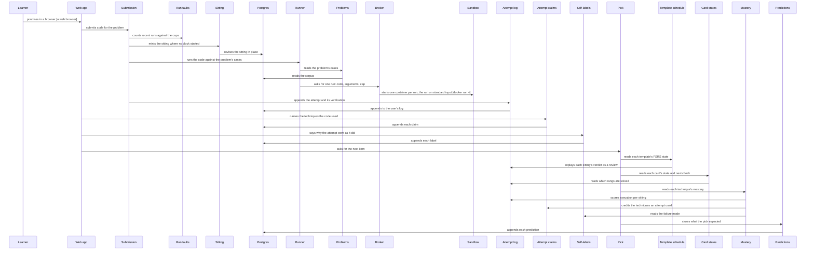

# Drill loop

Practice on a generated problem. The engine serves the statement, times the
sitting and judges the submission, and records what only the user can say.
`../web-app/pages/problems/problem/README.md` gives the page a sitting is
held on.

<!-- generated from model.toml by `just model-views`, never edited: the flow -->

<!-- end of the generated flow -->

1. The board, ordered by staleness. The user picks a technique. The
   technique's cards are linked from this step on.
2. Candidates for the technique, least recently attempted first, lowest solve
   rate breaking a tie. The user picks one.
3. Opening the problem serves its statement and mints nothing. The clock
   starts on the user's press, or at once where the clock preference is on,
   and the clock's start mints the sitting.
4. The submission runs against the problem's own test cases, and the attempt is
   minted carrying the result. A submission where no clock started mints the
   sitting first.
5. Keyed to each attempt, the loop asks for an attempt claim and then for a
   self-label, and one press stores both.

## 1. The board

- **The board offers every technique a served problem carries**, practised or
  not, and a technique never practised ranks stalest. A board of practised
  techniques alone opens the first sitting with nothing to pick.
- **Selection never schedules.** Ordering is a view. The user chooses what to
  drill, and the pick beside the lists is the schedule's offer, as
  `../api/pick.md` gives.
- **The card is offered, and no sitting requires it.** A user who holds the
  form solves straight away, and a user who does not reads the card first.
  Recognising a form with no card in view is a probe's test.

## 2. The candidates

- **A candidate is offered without its statement.** Opening the problem is
  the act that serves the statement, so the list stays a list of picks.

## 3. Opening the problem

- **No press stands between the pick and the statement.** A press that started
  the clock before the statement was shown made opening a problem a commitment,
  and the author avoided opening problems because of it.
- **Opening a problem records nothing.** `../api/sitting.md` gives why the
  sitting waits for the first clock press or the first submission. A user can
  then read any number of statements before choosing one to solve.

### The clock

- **The clock is shown, and the user starts it.** The clock does not run until
  the user presses start. A sitting whose clock never ran is untimed, and that
  is a legitimate way to practise.
- **The clock preference decides whether the next clock starts by itself.**
  The user's last press sets it: starting or resuming a clock turns it on, and
  pausing one turns it off. It is off until the user first starts a clock. The
  automatic pause on a hidden page sets nothing, or one tab switch would stop
  every later clock unnoticed.
- **The clock measures from its own start.** Reading done before the press is
  not counted, and the attempt carries the time the clock ran.
- **An attempt nobody timed stays untimed**, rather than carrying a duration
  reconstructed after the fact.
- **A running clock is paused and resumed**, and the elapsed time the attempt
  carries excludes every pause. `../api/sitting.md` gives what the record
  holds. A pause and a stop are one press: a paused clock stays paused until
  the user resumes it.
- **A paused clock leaves the page usable, and a submission is still taken.**
  A pause stops the timing, not the practice. The attempt carries the time the
  clock ran before the pause.
- **A hidden page pauses a running clock, and the page returning resumes it.**
  The clock counts the time on the problem, and a solver who left the tab is
  away from it. A clock the user paused stays paused when the page returns,
  since the page resumes only the pause hiding it started.
- **A sitting ends at the End press or at the idle bound `../api/sitting.md`
  gives.** A user who started a clock and left the page has nothing to close,
  and mastery reads nothing from a sitting with no submission.

### The editor

- **The editor proposes no name from the standard library.** The editor a
  sitting is typed into highlights syntax and indents. A solver offered
  `bisect_left` after three characters has recalled no form, and the sitting
  exists to measure recalling the form. The recall trainer in
  `recalling-a-template.md` holds the same rule.
- **The phone's keyboard offers the names the file already declares.** A
  variable, a parameter or a function the solver wrote is the solver's own
  word, and offering it back recalls no form. Retyping `nums` and `prefix` is
  the largest cost left on a phone's keys, where a physical keyboard makes it
  cheap. A name the file only imports is offered too, since typing the import
  was the recall.
- **The editor pairs a bracket or a quote as it is typed**, on the web and
  the phone alike. A closing bracket names nothing, so the pair recalls
  nothing for the solver, and the two editors then behave as one.
- **The editor opens on the user's latest code for the problem, where that code
  is work in progress.** The latest code is the newer of the unsent draft the
  browser holds and the code of the last attempt the engine stored. Reopening a
  half-solved problem continues it, where a blank file would cost the work.
- **Code from a solve is never carried.** The editor opens on the signature
  when the user's last attempt on the problem solved it. Prefilling an answer
  turns a re-solve into reading it, and nothing is then retrieved.
- **Code from before a card run is never carried into that run's problems.** A
  problem opened from a card with a run open carries only code written after
  the run began. The run measures solving from its start, as
  `../api/card-runs.md` gives.
- **A press restores the user's last solve into the editor.** The press is
  offered where the user has solved the problem before and the editor did not
  carry that code. The editor's undo takes the restore back.
- **An attempt made after a restore says so.** The attempt carries `restored`,
  and mastery does not count it as a solve. A solve typed over a restored solve
  is not an independent solve, as a hinted recall pass is not a pass.

## 4. The submission

- **A solved sitting takes further submissions.** A user who solved by brute
  force submits the better form in the same sitting. Ending the sitting at the
  solve split one session on one problem into two sittings. The second was
  solved on its first submission, so it counted as a second review and a
  second execution score of 1 at the same moment.
- **A sitting's verdict is read through its first solve.** The rating and the
  execution score read the attempts up to the first solve and no further. A
  later attempt that fails, on a form the user is trying, then leaves the
  verdict as it was.
- **A failing submission shows the first case it failed, whole**: the
  arguments, the expected value, and the value the submission returned or the
  exception it raised. An outcome on an input the solver cannot see is debugged
  by guessing, and guessing at an input is not the skill a sitting measures.
- **A cold sitting shows the number of the first failing case, and not its
  input**, as `../api/rating.md` gives.
- **The first case is first in the order the problem carries its cases.** The
  cases written with the statement come before the mutation loop's and the
  separating case, so a small example is shown where one fails.
- **The case is shown whatever its size.** A trimmed input is an input the
  submission never failed on.
- **A shown case can be special-cased, and nothing guards against it.** A
  solver can patch one input per submission until every case passes.
  `../README.md` gives why the loop does not guard a verdict. Each submission
  mints an attempt, so the patching stays readable in the log.

## 5. The claim and the label

- **A drill can mint several attempts**, and each is asked about in turn. A
  submission that failed on syntax and the one that passed are different
  evidence, and labelling only the last would leave the counts on two
  denominators: attempts per submission, labels per sitting.
- **The label and the claim are cheap only here.** The candidates are the
  problem's own two or three techniques, the drilled one is the default since
  selection picked the problem by it, and the attempt is minutes old. Two facts
  a classifier has to infer later cost a keystroke each at this moment.
- **The claim is asked before the label.** The claim asks which techniques the
  code used, and naming them puts the approach the solver took into words. The
  label then asks whether the solver held that approach, which is the question
  the claim has just framed.
- **One press stores the claim and the label.** The two answer one attempt, so
  a press each would have the solver confirm the same attempt twice.
  `../web-app/pages/problems/problem/claim-and-label.md` draws the overlay the
  two are asked in.
- **A skipped label stops nothing.** The loop moves to the next attempt of the
  sitting, and the attempt stays unlabelled. `../api/self-labels.md` gives
  what a skip leaves.
- **The loop does not retire a problem.** A statement that asks for something
  its cases do not decide is retired by hand, in the terminal, and
  `../api/problems.md` gives who retires one. A sitting can send a retirement
  request from under the statement, and the request retires nothing until the
  author acts on it, as `../api/retirement-requests.md` gives. A self-label
  written before the retirement stays, and the board's read-time exclusion
  keeps that attempt out of mastery.
