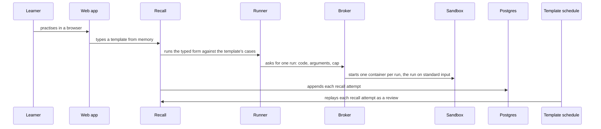

# Recalling a template

A form reproduced from memory, typed into a blank file and run against the
cases the template carries. Reading the form is not recalling it, so the
trainer never prints the form until the user asks for it as a hint.

<!-- generated from model.toml by `just model-views`, never edited: the flow -->

<!-- end of the generated flow -->

1. The user starts a recall on the card, or opens one template's recall by its
   slug.
2. The trainer draws one template where the user named none: never recalled
   first, then least recently recalled.
3. The template's trigger is shown, and its form is withheld. Its title is
   shown only on a recall the user opened by the template's slug.
4. The signature the cases call is shown, and the file is otherwise blank.
5. The user types the form, and asks for a hint where memory fails: the notes,
   then the form itself.
6. The file runs against the template's cases, under the runner a submission
   runs under.
7. A `RecallAttempt` is written, carrying the hints taken and how the cases
   went.

## 1. The start

- **The recall is addressed by the template's slug**, as
  `../web-app/pages/cards/recall/README.md` gives the path. A drawn recall that
  named nothing could not be reloaded, and the user could not ask for the form
  they mean to practise.
- **The user may ask for a template by name.** A card teaches several forms,
  and a rule that draws for them makes the one form a user wants to practise
  reachable only by exhausting the others.
- **The card's Recall section starts the recall of any form it lists.** The
  section already names every template and its recall state, so the row the
  user reads is the row that opens the recall.
- **A recall attempt needs no open card run.** The record is keyed to a card
  and a template, as `../api/recall.md` gives it, and the run measures the
  ladder rather than the recall.

## 2. The draw

- **The trainer draws by staleness, and the pick schedules.** A recall the
  user starts from the card draws never recalled first, then least recently
  recalled, which is the ordering the board uses for a technique. A recall the
  pick serves names its template, as `../api/pick.md` gives.

## 3. The trigger

- **The trainer withholds the form and names the template.** Typing the form
  from memory is the recall, and a user who knows which form is asked has
  still typed nothing. The title, the slug and the trigger all read on the
  page.
- **A drawn recall withholds the title all the same.** The trainer chose the
  form, so the trigger names it alone, and a draw measures mapping the trigger
  to the form. A recall the user asked for by name carries the title already,
  since they typed the name.
- **The trainer names every template of the card and switches between them.**
  A user practising one form reaches the next without returning to the card. A
  template no case checks is named and never opened, as
  `../content-repo/cards.md` has it read rather than recalled.

## 4. The signature

- **The signature is shown.** The cases call the form with a parameter order,
  and that order has to be stated somewhere, as
  `../cli/generation/test-cases.md` says of a statement. A signature the user
  infers wrongly fails every case for a form recalled correctly.
- **The file is otherwise blank, and the editor proposes no library name.**
  The editor `drill-loop.md` gives holds the same rule, and a solver offered
  `bisect_left` after three characters has recalled no form. The phone's
  keyboard offers the names the file declares, as in a sitting.

## 5. The hints

- **The hints are two, in one order: the notes, then the form.** Each answers
  more of the question than the last, so a record of which hint was taken says
  how far the memory reached. The title was the first hint until the page
  started naming the template, and `Hint` carries the two that are left. A
  drawn recall takes the same two, and its title is named by the result rather
  than bought as a hint.

## 6. The run

- **The trainer runs the file rather than comparing it with the stored form.**
  A comparison would fail a reproduction that renamed a variable, and pass one
  that copied the form with its loop condition inverted.

## 7. The result

- **The result names the template and offers its form.** The verdict, the
  cases and the hints taken read beside the title, and the form is revealed on
  a press rather than printed. A user who failed to recall a form learns which
  form it was, and decides whether to read it.
- **A hinted pass is recorded as a pass with its hints**, which
  `../api/recall.md` requires. Reading the form and typing it back is the last
  hint rather than a separate outcome, and the record says which hints were
  taken.

## Deferred

Only use answers each of these:

- How many templates one recall asks for before it stops.
- Whether a template authors a hint of its own beside the two.
- How a template whose form is a class is exercised, since the cases call one
  function.
- How a form answering with one of several valid orders is checked, since a
  case carries a value rather than a predicate.
- The step a failed recall leads to, which the scheduler settles.
