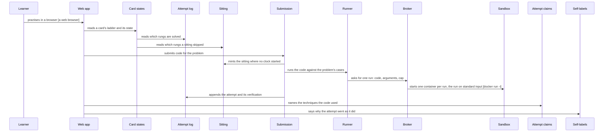

# Solving a rung

The card has the user solve problems, and each of them is a rung of its ladder.
The rung is picked on the card, sat as any problem is, and the sitting returns
to the card it came from.

<!-- generated from model.toml by `just model-views`, never edited: the flow -->

<!-- end of the generated flow -->

1. The ladder on the card: a rung per problem, each naming the templates it
   covers and whether it is required.
2. The user picks a rung.
3. The problem opens, named by the card the pick came from, and serves the
   statement as `drill-loop.md` gives.
4. The submission, the verdict and the claim run as `drill-loop.md` gives
   them.
5. The solve stays on the page, with a press back to the card, where the next
   rung is.

## 1. The ladder

- **The ladder follows the card's own template order.** A card authors its
  templates in the order it teaches them, and a rung covering the first
  template comes before a rung covering the third. The rungs the selector fills
  the ladder out with follow, least recently attempted first, as a technique's
  candidates are ordered. The ladder's first easy rung comes before all of
  them, as `../content-repo/cards.md` gives.
- **A rung names the templates it covers**, so the user reads why this problem
  is on this ladder. The templates also decide whether the rung is required,
  which `../content-repo/cards.md` derives rather than stores.
- **A retired problem fills no rung**, and the ladder is re-derived.
  `../content-repo/cards.md` gives both, and the attempts on the retired
  problem stay in the log.

## 2. The pick of a rung

- **A rung carries no statement**, as a candidate carries none. Opening the
  rung serves the statement, so the ladder stays a list of picks.
- **A rung is skipped where its last sitting since the run began ended with no
  submission**, by the End press or the idle bound. The skip is read from the
  sitting store, so no record marks it. An End press and an idle sitting count
  alike, since the store cannot tell a give-up from an interruption.
- **A skipped rung is served after the rungs not skipped.** The skipped
  problem gives way on the ladder to another problem covering the same
  templates, if one exists. Otherwise the rung keeps its problem and comes back
  once the rungs after it are solved or skipped.
- **A skip counts for nothing else.** Mastery reads nothing from a sitting with
  no submission, and FSRS rates no review from it, as
  `../api/template-schedule.md` gives.

## 3. The problem's page

- **The problem's page is the one a technique's candidates open.** A rung is a
  problem, and a second page for the same record would serve the same
  statement under another URL.
- **The page names the card rather than a technique**, since the user came from
  the card. The way back returns to the card, and the claim answers for the
  card's own technique.

## 4. The solve

- **Progress is a fold over attempts, never a mark on a rung.** A rung is
  solved where an attempt on its problem, finished after the run began, was
  solved. The rung carries no mark, so a ladder re-derived under a moved corpus
  keeps every rung the user already solved.
- **An attempt reached from the board counts too.** The fold reads the attempts
  on the rung's problem, whichever page served them, since the ladder measures
  solving rather than the route taken to it.
- **An attempt finished before the run began counts for nothing.** Having
  solved the problem once is not having studied the form. The run is minted to
  draw that line.

## 5. Back to the card

- **A sitting offers a press back to the card, and a solved one stays on the
  page.** A user reads a solve back after it passes, so the page does not leave
  by itself. A user solving a ladder is working through a list, and the press
  returns to the card rather than to the board.

## Deferred

Only use answers each of these:

- Whether the ladder is extended while a run is open, and what asks for more
  rungs.
- The card's reading where a required rung's problem was retired and no
  problem replaces it.
