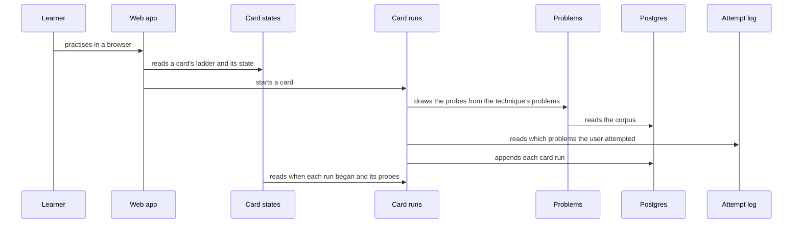

# Starting a card run

Studying a card is an explicit act. The user opens a card, reads it, and starts
a run when they mean to study the technique. The ladder is measured from that
start, and the probes are drawn at it.

<!-- generated from model.toml by `just model-views`, never edited: the flow -->

<!-- end of the generated flow -->

1. The card, opened from the Cards section or from a technique's page. The
   trigger, the brief and the templates read whether or not a run is open.
2. The user starts the run.
3. A `CardRun` is minted, carrying when the run began.
4. The probes are drawn from the corpus and stored on the run: a problem the
   card's technique carries, unseen first, then least recently attempted, and
   never one the ladder holds.
5. The card then shows its ladder, its templates with their recall state, and
   the probes the run was given.

## 1. The card

- **The card reads the same before the start and after it.** The trigger, the
  brief and the templates are the study material, and withholding them until a
  run opens would make starting a run the price of reading the card.
- **The ladder is shown before a run opens.** The ladder names the problems
  studying this card will have the user solve, and the user decides the start
  on that list. Progress against the ladder is shown once a run measures it.

## 2. The start

- **A locked card does not start.** The card reads in full, and the press
  starting the run names the required cards not yet met.
  `../api/card-states.md` gives when a card is locked and how a user who holds
  the forms meets a required card.
- **A card with a gap still starts.** A core template no solution displays is
  reported on the card, as `../content-repo/cards.md` requires, and the rungs
  the ladder does hold are still worth solving. Refusing the start would leave
  the user waiting on a problem nobody has written yet.

## 3. The run

- **A run is minted rather than inferred from an attempt.** A ladder problem
  solved before the card began does not count toward the ladder, and only a
  stored start says which attempts came after it.
- **The run holds no verdict.** Ladder progress, the recall state of each
  template, and the card state are folds over the attempts, the recall
  attempts and the corpus. `../api/card-states.md` gives why none of the three
  is stored.

## 4. The probes

- **The probes are drawn at the start, and never at import.** A problem unseen
  at import need not still be unseen when the user starts the card, and a
  probe the user has already solved tests no recognition.
- **The draw is a rule, and no model chooses a probe.** The rule reads the
  technique's problems, unseen first, then least recently attempted. A model
  asked to choose would answer the question the rule already answers, and it
  would answer it differently each time the same card was started.
- **The draw reads the technique rather than the selector's filters.** The
  filters narrow what the ladder teaches, and a probe asks whether the
  technique is recognised at all.
- **Whether a statement gives its own form away is not read here.** A
  statement naming its approach is a property of the corpus rather than of the
  pick, and its measurement is deferred.
- **A probe is stored on the run, not derived.** The draw reads the attempt log
  as it stood at the start, so a later attempt would change what a
  re-derivation returned. The probes the run offered have to stay readable.
- **Later probes append.** A run given another probe keeps the ones it was
  given first, so what was offered and when stays readable.

## 5. The card with its run

- **A probe opens the problem page a rung opens**, named by the card it came
  from. `solving-a-rung.md` gives that page.
- **A card is done once it graduates.** `../api/card-states.md` gives the five
  card states and what each one reads.

## Deferred

Only use answers each of these:

- How many probes a start draws.
- When a run is given a further probe, and what asks for one.
- Whether a card can be started again, and what a second run means for a
  ladder the first run already measures.
