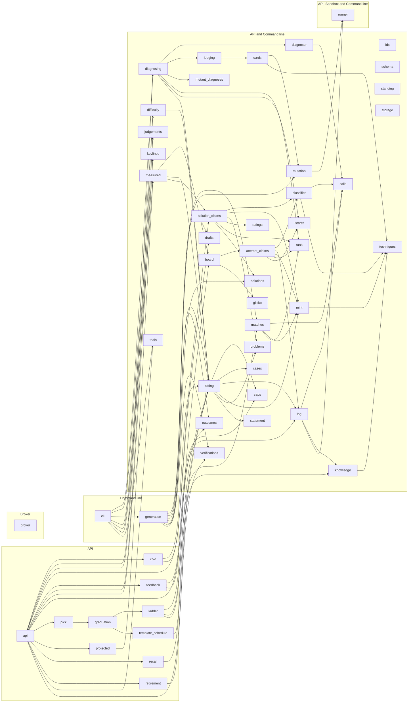

# Modules

The engine's Python packages and the imports between them, generated from
`src/climb` by `just module-graph`. A package is one directory or one file
directly under `src/climb`. A box groups the packages that the same containers
run. A container's `code` in `model.toml` names the modules its process runs
first, and a package belongs to every container whose `code` reaches it
through imports.

An arrow runs from a package to a package it imports. An import that a chain
of drawn arrows already implies is left out, so the graph shows the layering
and not every import. Every package may import `schema`, `ids`, `storage` and
`standing`, so no arrow into them is drawn. The first import contract in
`pyproject.toml` forbids them from importing the domain. The check fails on a
stale graph, and on a package that no container's `code` reaches.

Each container's `runs` in `model.toml` names the packages it runs, by hand.
The check fails on a package the container's `code` reaches and its `runs`
omits, and on a package its `runs` names and its `code` does not reach. A new
import that moves a package into another box then fails the commit. Without
the declaration the import only redraws the graph, and a reviewer has to
notice the diff.

A container's `code` is imported by nothing outside its own package. Each
container talks to another over a process boundary, so an import across that
boundary would run one container's code inside another. `just module-graph`
writes one import contract per container into `pyproject.toml`. The suite runs
the contracts, and the check fails on a stale contract. The hand-written layers
contract in `pyproject.toml` orders the packages inside a box.

The clients' TypeScript modules are drawn in `client-modules.md`.

<!-- generated by `just module-graph`, never edited -->

<!-- end of the generated graph -->
